```{=html}
<!-- Dynamic statistics: loaded once from pipeline output files (not shown in rendered document).
     Re-render the Quarto document after re-running merge or screening scripts. -->
```



```{r}
#| label: stats-bridge
#| include: false

stats_r <- reticulate::py$stats

library(ggplot2)
theme_review <- function() {
  theme_bw(base_size = 11) +
    theme(
      panel.grid.minor = element_blank(),
      panel.grid.major.x = element_blank(),
      panel.grid.major.y = element_line(colour = "grey90"),
      plot.title = element_text(face = "bold", hjust = 0.5),
      axis.title = element_text(face = "bold"),
      legend.position = "bottom",
      legend.title = element_blank()
    )
}
```
<!-- ZENODO (README kořen + 99_aux/zenodo/ + pre-submission-checklist, 20. 11. 2026).
     Tři records. OR 1–19 = journal SI (PDF + ESM.zip); kopie v zipu datasetu, ne čtvrtý DOI.
     Dataset 10.5281/zenodo.24362075 CC BY 4.0 @MikovaData2026
     Software 10.5281/zenodo.24362240 MIT @MikovaCode2026
     Protocol 10.5281/zenodo.24362475 CC BY 4.0 @MikovaProtocol2026
     Runner ≠ čtvrtý DOI. -->


# Highlights {.unnumbered}

<!-- Precision Agriculture template: 3–5 bullets. Counts after the
     runner. Not 22/26. -->

- A PRISMA 2020 review of soil-moisture estimation (2019–2026) with
  emphasis on unmanned aircraft systems and on what UAV campaigns
  actually report.
- Satellite observations dominate the screened corpus; UAV studies are
  fewer and supply operational flight and sensor detail at field scale.
- The main gap is incomplete reporting of campaign extent, thermal
  calibration, and geodetic quality control, not a lack of platforms.
- A 25-item Layer 1 reporting checklist and a soil-moisture module are
  proposed so future UAV SM studies can be compared.

# Impact {.unnumbered}

<!-- Template: one or two sentences on fit to the journal definition. -->

Field-scale soil moisture is a core input to site-specific irrigation
and other precision-agriculture decisions. This review shows which UAV
practices are reported in the literature and provides a reporting
checklist so campaigns can be compared and reused.

# Abstract {.unnumbered}

<!-- TEXT QUALITY: Abstract nechat až na konec. Teď je kostra Purpose /
     Methods / Results / Conclusion (web časopisu). Šablona má ještě
     Context / Aims / Implications — Purpose = Aims; Impact je zvlášť
     nad abstraktem. „methodologically important subset“ u UAV vs
     satelit NECHAT — to není must-cite. Dual UAV relevance nechat —
     to není dual screening. YAML abstract je bez live counts; tělo má
     stats_r. -->
<!-- NÁVRH TEXTU (česky, abstract až nakonec; anglicky sem nepište):
     Purpose: Půdní vlhkost je klíčová pro závlahu; satelit a in-situ
     nechávají mezírku na úrovni pole. Cílem je systematicky zmapovat
     odhad SM 2019–2026 s důrazem na UAV a na to, co kampaně reportují.
     Methods: PRISMA 2020, WoS + Scopus, rule-based skóre 0–8 + ruční
     kontrola; protokol retrospektivní (neregistrovaný). Direct UAV vs
     potential (satelit + optika/scaling) — potential se do skóre
     nepřičítá. Nástroje: Python skripty + lokální runner
     (70_scripts/runner/README.md), archiv @MikovaCode2026.
     Results (aktuální běh aplikace, po renderu stats_r): retained 1146,
     reviews 115, screened 1031; include 258 (25,0 %), maybe 723 (70,1 %),
     exclude 50 (4,8 %); must-cite 49 (22 core, 27 extended) z toho
     46 extrahovaných studií + 3 leftover (Hussain korekce, Surendran
     kapitola, Montzka konference). @Guo2026 je v OR 9–11.
     Satelit v korpusu převažuje; UAV je menší, ale nese provozní detail.
     Must-cite = priorita po skóre, ne „methodologically important subset“.
     Conclusion: mezera je v tom, co je v článku uveřejněno (extent,
     TIR drift, checkpointy, DOI; 0/45 veřejná a priori registrace,
     7/45 operační rámec nebo kalibrace výrobce, 38/45 metody jen
     retrospektivně), ne v nedostatku platforem. Checklist + SM modul.
     TIR: z textu často nepoznat, zda k cíli patřil — neříkat, že
     protokol neměli. YAML abstract nahoře je bez live counts; tělo
     pod Purpose/Methods/Results doplňte po překladu. -->

**Purpose.** *Soil moisture* is a key variable in agricultural monitoring
and water management and is increasingly evaluated using remote sensing
approaches. This study aims to systematically review recent advances in
*soil moisture estimation* with a focus on high-resolution and
*Unmanned Aerial Vehicle* (UAV)-applicable approaches.

**Methods.** A systematic review following PRISMA (*Preferred Reporting
Items for Systematic Reviews and Meta-Analyses*) 2020 guidelines was
done using Web of Science and Scopus. Bibliographic data were processed,
classified, and screened using custom Python-based tools combining
rule-based text analysis and manual validation. A dual UAV relevance
framework was applied to distinguish between direct UAV studies and
satellite-based approaches with potential UAV applicability.

**Results.** A total of `{r} stats_r['retained']` records were retained
after deduplication. After excluding `{r} stats_r['reviews']` review
articles, `{r} stats_r['non_review']` records were screened. Automated
screening classified `{r} stats_r['include_n']` records
(`{r} stats_r['include_pct']`%) as *include*, `{r} stats_r['maybe_n']`
(`{r} stats_r['maybe_pct']`%) as *maybe*, and `{r} stats_r['exclude_n']`
(`{r} stats_r['exclude_pct']`%) as *exclude*. A subset of
`{r} stats_r['must_cite']` records (`{r} stats_r['must_cite_pct']`%) was
flagged as *must-cite* (priority subset after scoring;
`{r} stats_r['must_cite_strict']` core, `{r} stats_r['extended']`
extended). Satellite-based studies dominated the full dataset, while
UAV-related studies represented a smaller but methodologically important
subset.
<!-- NÁVRH (Elena + abstract): vyhodit „methodologically important subset“.
     must-cite už má závorku (priority subset after scoring). 22 core / 26
     extended — všech 48 je přímé UAV. -->

**Conclusion.** The results highlight a strong reliance on satellite-based
approaches and reveal a gap between existing methods and their
implementation in UAV-based workflows. At the same time, scaling and
data fusion represent a key bridge between satellite and UAV
applications.
<!-- NÁVRH (Elena): zkratky — UAV a PRISMA v abstractu už rozepsané; SM tu
     nezavádíte (OK). V těle znovu při prvním výskytu (Elsevier/Harvard). -->

------------------------------------------------------------------------

# Introduction {.unnumbered}

## Importance of Soil Moisture {.unnumbered}

<!-- Lead author: Lenka Miková -->

<!-- Status: Done final  -->

<!-- co ma rikat 1. a co 2. odstavec? 1. puda je dulezita; 2. SM je komplikovane merit - proto to pisu -->

Soil is one of the key natural resources that is essential for
terrestrial ecosystems and human society. It is of fundamental
importance for agricultural production, as it is a source of water and
nutrients for vegetation and also creates a habitat for soil organisms
and other animals. At the same time, it significantly affects the
hydrological cycle and energy exchanges between the atmosphere and the
Earth's surface [@Babaeian2019; @Montzka2026; @Haokip2025; @Wang2024b].
Water availability <!-- soil vs. water management - neprohazovat--> is a
major determinant of crop yields and their stability. This availability
depends largely on soil properties, particularly soil structure
and organic matter content, which control water-holding capacity
[@Babaeian2019; @Ogwu2025; @Yang2025b]. In connection with climate
change and the growing pressure to increase agricultural production,
effective management of soil and water resources is becoming
increasingly important. Crucial to this management is soil moisture
(SM), which quantifies the actual water content stored within the soil
profile [@Babaeian2019; @Montzka2026]. Knowledge of the current state of SM is 
essential for agricultural water management and irrigation decision-making 
[@Chen2024; @Du2024; @Zappa2019; @Zhang2023]. Monitoring and estimating SM are 
therefore considered key biophysical and  decision-making pillars of precision 
agriculture [@Chu2026; @Hussain2025; @Senyurek2022].

However, accurately determining SM across spatio-temporal scales remains
a complex challenge. Existing approaches differ substantially in terms
of measurement accuracy, spatial scale, depth penetration, temporal
sampling frequency, and the nature of sampling (destructive vs.
non-destructive) [@Babaeian2019; @Haokip2025]. Methods for determining
SM directly in the field (in-situ) provide data for specific locations
and depths, whereas remote sensing methods allow for the monitoring of
continuous, large-scale areas [@Loconsole2025; @P2025]. The choice of
method depends on the purpose of the measurement, the required spatial
and vertical resolution, the target soil depth, and the available
technological resources.

The following subsections summarize the historical and technological development 
of remote sensing platforms and sensors employed to estimate SM, culminating in 
the recent emergence of unmanned aircraft systems (UAS) 
[@Babaeian2019; @Sishodia2020; @Acharya2021; @Loconsole2025; @Haokip2025].

------------------------------------------------------------------------

## Historical Progress {.unnumbered}

<!-- Author: Jan Komarek -->

<!-- Status: Done  final -->

{#fig-history}

<!-- opraveno AI, odmítnuto (Elena, 20. 11. 2026).
     Vráceno původní znění. Návrh AI (periodize / Table 1 and Figure 1) nepoužit. -->
The evolution of SM monitoring (@tbl-history, @fig-history) reflects a
progression from point-scale measurements and coarse-resolution
observations to multi-source observation and retrieval frameworks
[@Zhang2024; @Teixeira2025]. Prior to 2000, spatial quantification
relied mainly on in-situ methods such as gravimetric sampling, neutron
probes, and time-domain reflectometry [@Topp1980; @Abdulraheem2024],
complemented by early spaceborne microwave observations. Passive
microwave measurements were already available from sensors such as
NASA's Nimbus-7/SMMR [@Njoku1996], while C-band scatterometers aboard
ESA's ERS-1/-2 provided coarse-resolution observations with footprints
of tens of kilometres [@Wagner1999], leaving a pronounced scale gap
between in-situ measurements and satellite pixels [@Peng2021;
@Zappa2019]. During this formative period, the foundations for microwave
soil-moisture retrieval were established through dielectric models,
physical and semi-empirical vegetation scattering models, including the
Water Cloud Model [@Attema1978; @Dobson1985], and scatterometer-based
change-detection approaches [@Wagner1999].
<!-- NÁVRH (Elena): první věta je moc abstraktní jako úvod k tabulce/obrázku.
     Zjednodušit na to, co tabulka a Figure 1 dělají, ne „retrieval frameworks“.
     Např.: Table 1 and Figure 1 periodize SM monitoring from in-situ and
     scatterometer observations to multi-platform fusion. Pak teprve éra do 2000. -->

| Time Period / Phase | Platform Paradigm | Sensor Configuration | Dominant Modeling Approaches | Key Evolutionary Milestones |
|:--------------|:--------------|:--------------|:--------------|:--------------|
| **\[until 2000\]** | Ground-based measurements and satellites. Mapping at the watershed level using scatterometers. <br>{width="45"} {width="45"} | Satellite and ground-based sensors, TIR measurements emerge. | Development of fundamental crop and soil process and simulation models<!--such as DAYCENT, DNDC, CANDY and Expert-N-->. | SM research is growing. Low publication of articles on smart agriculture. |
| **\[2000–2008\]** | Satellites and the first applications on common agricultural technology. <br>{width="45"} | Optical sensors on satellites. | Dominance of methods such as fuzzy sets, information systems, decision theory and mathematical models. Models such as CropSyst RF are also emerging. | Defining the future direction of precision agriculture. The amount of research in smart agriculture is growing. |
| **\[2009–2014\]** | UAVs are moving into agriculture. The emergence of wireless sensor networks for irrigation automation. <br>{width="45"} {width="45"} | CRNS networks for moisture detection are emerging. | Computer simulation, decision support, cluster analysis, and land cover mapping. Irrigation design using ANN. | Growing academic interest in smart agriculture. Data collection for fusion from WSNs and satellites. |
| **\[2015–2018\]** | The advent of commercial IoT sensors and testing of UAVs with lightweight cameras. <br>{width="45"} {width="45"} | Integration of MS and RGB sensors on UAVs. Emergence of in-situ IoT SM sensors. | AI, Remote Sensing and ML. First CNN for UAV image analysis. | Rapid growth of precision agriculture publications. First links between AI and IoT towards farm automation. |
| **\[2019–2026\]** | Connected ecosystems: UAVs, IoT sensor networks, and high-resolution satellites. <br>{width="45"} {width="45"} {width="45"} {width="45"} | Multi-Sensor Data Fusion (RGB, MS, HS, and TIR) and UAV-GPR. | Advanced AI (DL, Transformers), Spatio-Temporal Data Fusion, and Edge Cloud Computing. Digital twins appear in reviews as an emerging framing [@Tsaousidis2026]. | Rapid growth of data fusion and AI research. Shift towards automated, real-time decision-making. |

: Chronological evolution of platforms, sensors, and modeling approaches in precision agriculture soil moisture studies, compiled from a selected subset of existing review articles (listed in @or-reviews). An overview of the icons is given in @or-icons. {#tbl-history}

*Note: AI = Artificial Intelligence; ANN = Artificial Neural Networks; CRNS = Cosmic-Ray Neutron Sensing; DL = Deep Learning; GPR = Ground-Penetrating Radar; HS = Hyperspectral; IoT = Internet of Things; ML = Machine Learning; MS = Multispectral; RF = Random Forest; TIR = Thermal Infrared; UAS/V = Unmanned Aerial System/Vehicle.*

Between 2000 and the mid-2010s, dedicated microwave missions and
improved retrieval algorithms substantially advanced global SM
monitoring [@Peng2021; @Teixeira2025]. JAXA/NASA's AMSR-E (2002),
EUMETSAT's ASCAT (2006), ESA's SMOS (2009), and NASA's SMAP (2015)
provided global SM products with improved spatial and temporal coverage
[@Njoku2003; @Wagner2013; @Kerr2010; @Entekhabi2010], while optical and
thermal sensors such as USGS/NASA's Landsat and NASA's MODIS supported
indirect estimates via surface and vegetation proxies [@Sandholt2002].
Alongside these missions, wireless sensor networks enabled increasingly
distributed field observations [@Bogena2022; @Li2020], while Cosmic-Ray
Neutron Sensing (CRNS), introduced by @Zreda2008, provided observations
at intermediate spatial scales [@Heistermann2023]. The International
Soil Moisture Network (ISMN, initiated in 2009) strengthened
ground-based validation of satellite products [@Dorigo2011].

From around 2010, in parallel with these satellite developments, the
rapid adoption of UAS enabled flexible, fine-scale observations at
centimetre- to decimetre-level resolution [@Paruta2021; @Chavez2020;
@Acharya2021], helping to bridge the spatial-scale gap between in-situ
measurements and satellite observations [@Chakhar2021]. Lightweight
multispectral and thermal cameras enabled high-resolution mapping of
SM-related surface properties, although SM was generally inferred
indirectly [@Araya2021; @Zhang2023; @Yin2024] and thermal measurements
required careful radiometric calibration [@Kelly2019; @Chavez2020]. From
the late 2010s onward, UAS observations have increasingly been combined
with networked in-situ sensors [@Bogena2010; @Bogena2022], including
IoT-enabled systems [@Zhang2024], and with Sentinel-1/2 and Landsat data
[@Shokati2025; @Bauer-Marschallinger2019], while machine-learning
approaches, from artificial neural networks to deep learning, have been
increasingly applied to multi-sensor fusion, retrieval and downscaling
[@Zhang2023; @Yin2024].

Microwave payloads were prototyped on small UAS as early as 2010, when a
lightweight L-band radiometer was first used for SM retrieval
[@Acevo-Herrera2010], but they have remained rare. UAS-based Global Navigation 
Satellite System - Reflectometry (GNSS-R) and L-band
radiometry have been demonstrated or simulated mainly in recent years
[@Senyurek2022; @Farhad2025], and an airborne simulation of UAV
observations indicated higher sensitivity of L-band emission to
near-surface SM than thermal-optical approaches [@Ye2024], yet these
systems remain at an experimental stage. UAS-borne radar, including
ultra-wideband and GPR, has also emerged as a specialised approach to
shallow-subsurface SM mapping [@Wu2019; @Guo2022]. Despite these
advances, retrieval remains constrained by limited direct sensitivity to
subsurface and root-zone moisture [@Albergel2008; @P2025], vegetation
effects, soil texture and roughness, site-specific calibration and
limited transferability [@Dopper2022; @Teixeira2025].

------------------------------------------------------------------------

## Existing reviews and Research Gap {.unnumbered}

<!-- Author: Lenka Miková -->

<!-- Status: Done final -->

A total of `{r} stats_r['reviews']` review articles addressing SM or the general 
application of UAVs in agriculture were identified during the literature search 
described in the “Review Methodology” section [e.g., @Acharya2021; @Mowla2026].
These reviews were excluded from the systematic analysis and retained solely as 
background material. A selected subset is compared in @or-reviews, chosen to 
contrast SM-centred satellite and in-situ reviews with UAV-application reviews 
in which SM is addressed only marginally. @tbl-review-category groups a 
representative sample of these UAV reviews by application domain.

| Domain | Monitored parameters | Sensors and technologies used on UAV | Practical use and main findings | Resources |
|:--------------|:--------------|:--------------|:--------------|:--------------|
| **Hydrology and water management** | **SM**, precipitation, surface runoff, water level, bathymetry, snow cover, erosion. | RGB, TIR, miniaturized UAV-GPR and microwave systems. <br> {width="35"} {width="35"} {width="35"} | Flexible, cost-effective and fast data collection, areal moisture distribution and map water resources. | [@Acharya2021] |
| **Precision Agriculture and Crop Yield** | **SM**, Canopy Temperature, CWSI, NDVI, ET, Disease, Weed and Nutrient Status Detection. | MS, HS and TIR, RGB, LiDAR. <br> {width="35"} {width="35"} {width="35"} {width="35"} 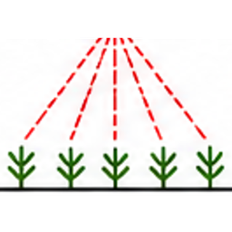{width="35"} | Yield Prediction, Variable Fertilizer and Spraying Rate and Effective Detection of Biotic and Abiotic Stress. Identification of Water Status Variation and Controlled Precision Irrigation. | [@Ali2024; @Awais2023; @Balathandayutham2025; @Ezenne2019; @Mowla2026] |
| **Ecosystems and landscape mapping** | Energy and $CO_2$ fluxes, total vegetation biomass, soil degradation, wetland mapping and **SM conditions**. | TIR and MS, image processing using SfM. <br> {width="35"} {width="35"} | Monitoring the health of large ecosystems, UAVs with thermal sensors detect places with high evaporation and moisture. Very high resolution landscape structure data. | [@Jeziorska2019; @Acharya2021] |

: Selected existing UAV reviews grouped by application domain.
{#tbl-review-category}

Since the late 2010s, research has been shifting from the use of a single 
platform to combinations of platforms and data sources [@Bazrafkan2025; @Saki2025] 
(@or-fusion). Individual platforms have spatial, temporal or operational 
limitations [@Teixeira2025; @Huang2026] (@tbl-review-sm). While ground-based 
networks enable highly accurate and continuous SM measurements, scaling them 
up to large areas is neither cost-effective nor time-efficient [@Bogena2022; @Loconsole2025]. 
Satellite remote sensing offers broader spatial coverage, but at a lower spatial 
resolution and with potential interference from cloud cover or dense vegetation 
[@Mkhwenkwana2025; @Pablos2025]. Combining UAV and satellite imagery allows 
their complementary spatial characteristics to be used [@Bazrafkan2025; @Teixeira2025], 
and combining UAV data with in-situ data enables ML models to derive root-zone 
SM [@Haokip2025; @Dong2024]. The integration of satellite, UAV, and in-situ 
data using ML is therefore an increasingly common research direction [@Dong2024; @P2025; @Tsaousidis2026].

| Monitoring Paradigm | Platform Combinations | Core Benefit & Processing Strategy | Representative Sources |
|:-----------------|:-----------------|:-----------------|:-----------------|
| **Isolated Platforms** | In-situ only, Satellites only, UAVs only | Basic data with limitations in coverage, frequency and measurement depth. | [@Bogena2022; @Mkhwenkwana2025; @Dong2024] |
| **Partial Data Merging** | UAV + In-situ, Satellite + UAV, Satellite + In-situ | Reducing the limitations of individual platforms using ML, e.g. refining satellite maps with UAV data and calibrating UAV images with in-situ probes for the root zone. | [@Haokip2025; @Bazrafkan2025; @Teixeira2025] |
| **Complex Integration** | Satellites + UAVs + In-situ | Connecting spatial, temporal, and depth data using DL. Digital twins appear in the review literature as an emerging framing, not as an operational SM irrigation system. | [@P2025; @Saki2025; @Tsaousidis2026] |

: Overview of SM monitoring platforms and data fusion trends. Detailed
sensor specifications, resolutions, and key findings are provided in
@or-fusion. {#tbl-review-sm}

<!-- NÁVRH (Elena + kluci): překlep AUV → UAV. Odstavec po Table 3 říká totéž
     co Aim kratšími slovy — smazat, nebo nechat jednu větu mostu k Aim
     (These reviews do not evaluate UAV acquisition and reporting for SM). SMAZANO-->

------------------------------------------------------------------------

## Aim and Scope of this Review {.unnumbered}

<!-- Author: Lenka Miková -->

<!-- Status: Done final -->

Although UAVs are increasingly used in agriculture, existing studies provide 
only limited methodological guidance for SM estimation using UAVs 
[@Acharya2021; @Teixeira2025; @Yang2025a]. In particular, standardized 
procedures for UAV data acquisition and processing are lacking, including 
flight parameters and sensor configuration [@Mowla2026; @Jeziorska2019], 
radiometric and geometric calibration [@Bazrafkan2025; @Yang2025a], 
georeferencing [@Jeziorska2019; @Mowla2026], the design and spatial scheme
of validation measurements [@Kaivosoja2021; @Lagiewska2025], time 
synchronization with ground data [@Awais2023; @Saki2025], and uniform 
metadata reporting [@ParraLopez2025; @Mowla2026]. This significantly 
limits the comparability, reproducibility, and broader applicability of 
published results [@Kaivosoja2021; @Lagiewska2025; @Mowla2026].
<!-- to je jeho podstata; odstavce nenavazuji; přesunuto z predchozi kapitoly-->


To address this gap, this systematic review summarizes approaches to measuring 
and estimating SM using UAS, including the sensors, methods, and applications 
used, alone or in combination with satellite and in-situ data. 
It further evaluates the reporting of platform specifications, sensor 
specifications, flight and acquisition settings, data/output characteristics, 
and data processing specifications. Based on this evaluation, the review 
proposes a 25-item reporting checklist and an SM-specific module to support 
the comparability and reproducibility of UAS-based SM studies.
This list outlines the minimum scope of information that a UAS-SM study 
should provide. Without it, comparing individual studies is difficult.

The review covers studies published between 2019 and 2026 that used UAS for SM 
monitoring or estimation. Other UAV applications in agriculture, such as yield 
prediction or disease detection, are outside the scope of this review. 


------------------------------------------------------------------------

# Review Methodology {.unnumbered}

<!-- Lead author: Lenka Miková -->

<!-- Status: Done final -->

Parts of the review process were automated (@fig-prismadig) to enhance transparency, auditability, and
reproducibility. The systematic review adhered to the recommendations
set out in the PRISMA 2020 guidelines for systematic reviews
[@Page2021b; @Page2021a]. The completed PRISMA 2020 checklist detailing the reporting 
locations of all items is provided in @or-prisma-check. The review protocol was not registered, 
and no a priori protocol was prepared; a retrospectively compiled protocol following PRISMA-P 
is deposited at Zenodo [@MikovaProtocol2026].

The search was conducted on April 29, 2026. Equivalent search queries for Web of Science (Clarivate Analytics) 
and Scopus (Elsevier) were generated by a Python (v.3.11.1) script, which minimized the risk 
of discrepancies arising from the manual transcription of syntax. This script and other custom scripts 
used in this study are archived at Zenodo [@MikovaCode2026], together with a separate dataset
containing the screening data and extraction tables [@MikovaData2026]. 
Development versions are maintained on GitHub ([UAS-review](https://github.com/LenkaMikova/UAS-review) and 
[PRISMAtools](https://github.com/LenkaMikova/PRISMAtools)). Zotero (v.9.0.6) was used for citation management and the manual screening of selected records.

<!-- APLIKACE / README (22. 11. 2026): README runneru existuje
     (`70_scripts/runner/README.md`, start `run_review.bat`). V těle
     článku teď není jmenovaný — jen GitHub UAS-review + Zenodo
     @MikovaCode2026. Elena: runner nejmenovat v Methods. Sem nic
     nepřidávat. Návrh česky do Code Availability (za Data Availability):
     Skripty a lokální rozhraní (README v 70_scripts/runner/) jsou
     v software záznamu @MikovaCode2026; živá kopie GitHub UAS-review.
     Bez pátého DOI. -->
<!-- NÁVRH (Elena + methodology-vs-pipeline): dva GitHub odkazy spojit slovem
     and. RUNNER: ne samosatane jen jako soucast @MikovaCode2026 (celek 4 = 70_scripts včetně
     runneru). Větu o rozhraní ne sem (Methods = co recenze použila),
     ale do Code Availability hned za Data Availability.  --> 

![PRISMA 2020 flow diagram. Record counts for each processing status,
together with the complete merge and deduplication log, are reproduced
in @or-processing. Produced with the PRISMA2020 web application
(<https://estech.shinyapps.io/prisma_flowdiagram/>) [@PRISMAfd2022].
How the counts were assigned to boxes is in
@or-prisma-flow.](../60_prisma/PRISMA_diagram.png){#fig-prismadig}

<!-- DIAGRAM: PNG z webu Haddaway PRISMA2020 (estech.shinyapps.io), @PRISMAfd2022.
     Čísla 1636 − 479 − 11 = 1146; 1146 − 1097 = 49; 49 − 3 = 46/46. OK.
     Make PNG v runneru nepřepisovat — automatické boxy tam pořád berou
     screened 1031 a other exclusions 3. -->

------------------------------------------------------------------------

## Data Selection {.unnumbered}

<!-- Lead author: Lenka Miková -->

<!-- Status: Done final -->

Records were retrieved from Web of Science and Scopus. The final query 
combined five thematic groups:
**target variable** (soil moisture), **observation method** (remote
sensing), **platform** (UAV, UAS, drone, satellite), **application
area** (agriculture-related terms, e.g., agricultural land, arable land,
farmland, and bare soil), and **methodological approach** (precision
agriculture, irrigation, water management, downscaling, multi-scale
analysis, data fusion). Search terms were applied to the title,
abstract, and keywords fields. The search was restricted to publication years
2019–2026 and the English language. The complete search strings created
for both databases are listed in @or-search.

In total, `{r} stats_r['wos']` records were retrieved from Web of
Science and `{r} stats_r['scopus']` records from Scopus (`{r} stats_r['merged']` 
records before duplicate removal; @fig-prismadig). 
The records were exported in RIS format. After duplicate removal and data cleaning, 
`{r} stats_r['retained']` records were retained for further processing.
<!-- DOI: retained po novém auditu zahrnuje i záznamy bez DOI (nejdou
     automaticky pryč). Číslo dodá stats_r['retained']; staré 1133 / 503
     v diagramu a v OR 4 položce 5 (exclusion without DOI) opravit. -->
<!-- retained = record_decisions n_forward, else correct_record.
     duplicate_doi / duplicate_title / missing_doi / books / removed
     jsou pojmenované klíče v stats. --> 


------------------------------------------------------------------------

## Data Workflow {.unnumbered}

<!-- NÁVRH (U každého kroku
     automated/manual v textu. Duplicity: vyšší forma do závorky.
     Počty z stats_r (duplicate_doi, duplicate_title, missing_doi, books, removed).
     UAV potential v kódu: satellite AND
     (high/fine resolution OR scaling OR optical/MS/HS). -->

<!-- Lead author: Lenka Miková -->

<!-- Status: Done  -->

Records from both databases were imported and merged into a single dataset. 
The dataset was cleaned by a rule-based script and then checked manually.
Duplicates were identified automatically by DOI (`{r} stats_r['duplicate_doi']` records) and by title and year (`{r} stats_r['duplicate_title']` records), and verified manually.
Where metadata conflicted, records were compared manually. <!-- jak bylo a proc?; vyssi forma vyhrala - do zavorky-->. 
Journal articles were kept over conference papers or book chapters.
For disputed DOIs, the record with more complete metadata was kept. 
Records without a DOI were retained and checked manually for duplicates.
<!-- DOI: tělo, OR 4 položka 5 a PRISMA-P šablona: bez DOI se nevyřazuje.
     Figure 2 other = 11 (3 knihy + 8 mimo původní seznam). -->
Duplicates (`{r} stats_r['n_duplicates']` records) and `{r} stats_r['books']` books were removed (`{r} stats_r['removed']` records in total).
<!-- DOI: removed = duplicity + knihy. Až merge přestane vyhazovat
     missing_doi, stats_r['removed'] klesne a 22 v něm nesmí zůstat. -->
Conference papers and book chapters were kept for screening. 
All records, including the removed ones, are listed in one
dataset with the reason for exclusion.
<!-- NÁVRH (kluci + methodology-vs-pipeline): „forscreening“ → for screening.
     Tělo už má journal over conference a sporné DOI — OK.
     Počty duplicit/knih/removed z stats_r. Nová politika: bez DOI zůstanou.
     Figure 3 nemá legendu auto/ručně
     (má ji jen PRISMA) — přidat do caption, nebo u každého kroku slovo
     automated / manual. --> 

<!-- opraveno AI, schváleno (kluci, 20. 11. 2026).
     Původní: The same script than assigned thematic attributes…
     Nové: The same script then assigned… -->
The same script then assigned thematic attributes based on titles, abstracts, 
and keywords: platform, sensor type and acquisition mode, application 
domain, methodological approach, and scaling strategy. 
UAV relevance was evaluated at two levels. Direct relevance meant that UAV, 
UAS, or drone appeared in the title, abstract, or keywords. 
Potential relevance meant a satellite study that also mentioned high spatial 
resolution, scaling, or optical (multispectral or hyperspectral) sensing.
Potential relevance did not add points to the relevance score.
<!-- NÁVRH (Elena + kód): Direct = UAV/UAS/drone v TI/AB/KW. Potential v kódu
     = satellite (nebo MODIS/Landsat/Sentinel) AND (high/fine resolution OR
     scaling OR optical/MS/HS). Thermal do potential nepatří. Body skóre 0–8
     se za potential nepřičítají. Totéž podruhé v Dataset Overview nepsat. -->
Of the `{r} stats_r['retained']` records, `{r} stats_r['reviews']` 
were review articles and were excluded. The remaining `{r} stats_r['non_review']` 
records went to screening. These steps are shown in @fig-workflow. 
<!-- ne jako prvni vetu, klidne nakonec nebo rozpustit-->

{#fig-workflow}
<!-- opraveno AI, schváleno (Elena, 20. 11. 2026).
     Původní caption: Processing, classification, and screening workflow.
     Nové: stejná legenda auto/ručně jako u Figure 2. PNG po auditu zkontrolovat. -->
<!-- DIAGRAM: Figure 3 (workflow.png) po finálním auditu zkontrolovat.
     Kroky musí sedět s textem: DOI → title → No DOI (bez DOI se
     automaticky nevyřazuje). Doplnit legendu auto/ručně jako u Figure 2. -->
<!-- NÁVRH (Elena): Figure 3 nemá legendu auto/ručně (tu má jen PRISMA).
     Stejnou legendu do caption, nebo v textu u každého kroku automated /
     manual. Elena nechce, aby čtenář skládal metodiku z obrázku. -->

------------------------------------------------------------------------

## Dataset Overview {.unnumbered}

<!-- NÁVRH (navrhy-upravy-spoluautori.md + methodology-vs-pipeline.md):
     Skripty pryč. Score 0–8 z title/abstract/keywords; váhy + proč.
     Must-cite = screening_and_deep_classify.py, NE extraction_templ.py.
     V Excelu je všech 48 přímé UAV: 22 score 8 (scaling), 26 score 6
     (bez scaling, uav_potential True). Vrstva se jmenuje extended.
     Starý report: audit vyhodil i 22 missing DOI, nejen 3 knihy; tělo ve
     Workflow teď říká retained. Po novém merge přepočítat. PRISMA 925 full-text
     je aritmetika, ne krok. 48 vs. 45 k fig-distribution. Tři leftover
     odstavce smazat. Protokol: retrospektivní, Zenodo celek 1 (OR 4). -->

<!-- Lead author: Lenka Miková -->

<!-- Status: Done  -->

<!-- TEXT QUALITY: Příběh kapitoly nechat: skóre 0–8 → include/maybe/exclude → must-cite 22+26=48 → extrakce 45. „This classification allows a clear distinction…“ a tři leftover odstavce už jsou pryč. UAV two-level relevance už je ve Workflow — stačí jednou. -->

<!-- Seznamy 48/45: 30_screening/32_exports/must_cite_list.xlsx (Scaling_type + Scaling_source). HIGH = 22 automaticky, 26 ručně. -->

<!-- opraveno AI, schváleno (Elena + kluci, 20. 11. 2026).
     Původní: The relevance score (0-8) was assigned each record based in
     the title, abstract and keywords. Keywords weights were set…
     Nové: was assigned to each record based on … Keyword weights… -->
The relevance score (0–8) was assigned to each record based on the title, 
abstract and keywords. Keyword weights were set according to the focus of 
this review: direct UAV/drone/UAS terminology (+3), soil moisture (+2), 
scaling or data fusion (+2), and agricultural context (+1). UAV and soil 
moisture had the highest weights  because they define the topic of the review.
Scaling terms were added because the review also looks at combining UAV 
data with other data sources, and agricultural terms kept the agricultural context.
Records were classified as *included* (score ≥ 6), *maybe* (score 3–5), or *excluded*
(score \< 3). A record without a UAV term could get at most 5 points, so purely 
satellite studies were never classified  as *include*. 
Automated screening classified `{r} stats_r['include_n']`
records (`{r} stats_r['include_pct']`%) as *include*,
`{r} stats_r['maybe_n']` records (`{r} stats_r['maybe_pct']`%) as
*maybe*, `{r} stats_r['exclude_n']` records
(`{r} stats_r['exclude_pct']`%) as *exclude*. The threshold was set low
so that potentially unsuitable records would remain marked as *maybe*
rather than being excluded. Subsequently, the automatically generated
scores were manually verified.
<!-- RUČNÍ KONTROLA: výstup skriptu se nepřepisuje.
     Audit: porovnání duplicit (který záznam zůstane) + výběr záznamů
     co postoupí → record_decisions.json + forward_records.xlsx.
     Screening / Extraction: „Upload after manual check“
     → {stem}_after_manual_check.xlsx.
     Na Zenodo obojí: skript + rozhodnutí.
     merge: classification_review.json + audit_saved.txt (Save)
     a record_decisions / forward_records;
     skóre: screened_records.xlsx (skript) + screened_records_after_manual_check.xlsx;
     scaling none: must_cite_list.xlsx + HIGH_Scaling_none_with_abstracts.xlsx;
     extrakce 45: extraction_input_*.xlsx (šablona) + extraction_filled_after_manual_check.xlsx.
     processing_report dokládá skript, ne ruční rozhodnutí. -->
<!-- NÁVRH (Elena + kluci): název skriptu pryč. Score 0–8 z title, abstract,
     keywords; minulý čas (was assigned). Proč váhy: SM a UAV = zahrnovací
     jádro; scaling/fusion = přenositelnost; agriculture = kontext. Prahy
     ≥ 6 / 3–5 / < 3 nechat. Potential not in score — odkázat na Workflow. -->

Results are reported as absolute counts and relative proportions. The studies 
differed too much in design, data, and evaluation metrics for a meta-analysis.

A subset of studies was flagged as *must-cite* using a two-tier approach.
This was done automatically from the same scores and then checked manually.
**Core studies** had a relevance score ≥ 7, direct UAV usage, and scaling
approaches. **Extended studies** had a score ≥ 6 and direct UAV usage,
without a scaling phrase in the title, abstract, or keywords.
<!-- NÁVRH NA EXTENDED (jen česky; nahradit dvě věty Core/Extended výše):
     Core: skóre ≥ 7, přímý výskyt UAV/UAS/drone v názvu, abstraktu nebo
     klíčových slovech a scaling fráze (downscaling / data fusion /
     multi-scale). Must-cite jako celek vznikne dvěma větvemi skriptu:
     (A) skóre ≥ 6 a přímé UAV a scaling, nebo (B) skóre ≥ 6 a
     uav_potential a (scaling nebo optical/MS/HS). Extended = must-cite
     minus core. V tomto Excelu má všech 49 must-cite přímé UAV; 22 má
     skóre 8 (core), 27 skóre 6 (extended). Extended tu nejsou satelitní
     studie k přenosu na UAV, ale UAV záznamy bez scaling fráze, které
     prošly větví B (typicky UAV + satelit a optical/MS/HS v abstraktu).
     Čísla: 49 must-cite (22 core, 27 extended). -->
<!-- METODIKA vs APLIKACE (22. 11. 2026) — upravit až budete psát anglicky.
     Sedí: PRISMA 2020, WoS+Scopus 29. 4. 2026, pět skupin v dotazu,
     váhy SM+2 UAV+3 scaling+2 zemědělství+1, prahy include ≥6 / maybe 3–5
     / exclude <3, potential se do skóre nepřičítá, knihy pryč, konference
     a kapitoly zůstanou, bez DOI se nevyřazuje, skóre z TI/AB/KW,
     must-cite flaguje screening (ne extraction_templ), core = skóre ≥7
     + přímé UAV + scaling. Python v textu 3.11.1; runner chce 3.10+.
     Nesedí (doplnit v Dataset Overview):
     1) Extended v článku = skóre ≥6, přímé UAV, bez scaling fráze.
        Ve skriptu (screening_config.json) je must_cite = (skóre≥6
        a přímé UAV a scaling) NEBO (skóre≥6 a uav_potential a
        (scaling nebo optical/MS/HS)). Extended = must_cite minus core.
        V Excelu je všech 49 přímé UAV; 22 skóre 8, 27 skóre 6.
     2) Dual UAV relevance nerozdělilo include na direct vs potential;
        potential je jen příznak. Include bez UAV termínu max 5 bodů.
     3) Removed po renderu: duplicity 479 + 3 knihy, ale stats_r removed
        = 490 (8 záznamů držených lockem mimo původních 1133).
     4) Figure 2: sought v JSON = 49; box Included studies prázdný;
        nesmí zůstat 925 excluded after full-text.
     5) Protokol retrospektivní — v Methods už je; OK. -->
A subset of `{r} stats_r['must_cite']` records
(`{r} stats_r['must_cite_pct']`% of non-review studies) was identified
as highly relevant (*must-cite*), further divided into
`{r} stats_r['must_cite_strict']` *core studies*
(`{r} stats_r['core_pct']`%), `{r} stats_r['extended']`
*extended studies* (`{r} stats_r['extended_pct']`%).
<!-- 2026-11-22 screening: must-cite 49 = original 48, none dropped, + Fenhe
     maize root-zone UAV MS (@Guo2026; 10.1080/10106049.2026.2651610;
     extended, score 6). Řádek je v OR 9–11, or-uav, or-uav-param; ne v
     or-uav-param-core (jen core). App Extraction = 22 core + 27 extended.
     Tištěná věta Extended je pořád užší než skript — viz komentář
     NÁVRH NA EXTENDED u Dataset Overview. -->
<!-- NÁVRH (Elena + methodology-vs-pipeline + věcná chyba rozsahu):
     extraction_templ.py must-cite NEFLAGUJE — jen export už oflagovaných.
     Flag je ve screening_and_deep_classify.py. must_cite_strict v závorkách
     do těla nepatří. Pravda z Excelu: všech 48 uav_applicability = True.
     22 score 8 (přímé UAV + scaling) = core; 26 score 6 (také přímé UAV,
     scaling prázdný, uav_potential True) = extended. RIS:
     extended_studies.ris. stats_r['extended'].
     uav_relevance = transferable nechat — to je satelitní potential,
     ne vrstva 26 studií.

     SEM vysvětlení, proč v analýze jen UAV (ne do Aim):
     Without a UAV/drone/UAS term (+3) a record can score at most
     soil moisture (+2) + scaling (+2) + agriculture (+1) = 5, i.e. maybe.
     Purely satellite studies therefore could not reach include or the
     must-cite extraction set.

     Text must-cite: The same scoring rules then flagged a must-cite
     subset (automated, then checked): core (score ≥ 7, direct UAV,
     scaling) and extended (score ≥ 6, direct UAV, no scaling phrase).
     PRISMA box Must-cite nemá být plná červená. -->

Records classified as *include* and *maybe* were kept as the full dataset. Data 
were extracted only from the *must-cite* studies, and the extracted fields were 
completed from the full text. Data analysis was conducted using a combination of 
descriptive statistics and categorical aggregation. The analysis focused on 
platforms, sensor types and acquisition modes, application domains, methodological 
approaches, and scaling strategies. Keyword frequency analysis was performed using 
rule-based text matching applied to titles, abstracts, and keywords. The resulting 
keyword frequencies are listed in @or-keywords.


{#fig-VOS-must}

<!-- VOS_must-cite.ris (n = 48 = core 22 + extended 26).
     Export: extended_studies.ris. -->

Keyword co-occurrence analysis was performed in VOSviewer (v.1.6.20) [@VOSviewer2010]
and presented in @fig-VOS-must. The RIS file with `{r} stats_r['must_cite']` must-cite
articles was imported to the VOSviewer. The tool settings were as follows: Type of analysis:
Co-occurrence; Unit of analysis: Keywords; Counting method: Full
counting; Minimum number of keyword occurrences: 5. Out of a total of
6,582 keywords, 26 items were visualized.
<!-- opraveno AI, schváleno (kluci, 20. 11. 2026).
     Původní: 26 items were visualized and divided into four clusters.
     There were 275 links, and the total link strength reached 1,074.
     Link strength shows in how many articles two keywords appear together.
     Nové: 26 keywords (occurrence ≥ 5) formed four clusters; link
     strength is the summed co-occurrence weight… Nastavení VOSviewer
     beze změny. 48 ≠ 45. -->
These 26 keywords (occurrence ≥ 5) formed four clusters; link strength
is the summed co-occurrence weight across the `{r} stats_r['must_cite']`
must-cite records.
<!-- NÁVRH (kluci): jedna věta místo surových čísel: 26 keywords
     (occurrence ≥ 5) formed four clusters; link strength is the summed
     co-occurrence weight across the 48 must-cite records. Nastavení
     VOSviewer nechat. 48 = core + extended (včetně 3 ne-extrahovaných),
     ne 45 unique studies. -->

<!-- FENHE u @fig-distribution: není tabulka, ale ggplot z
     40_extraction/41_input/extraction_input_refined.xlsx (Priority HIGH).
     Přidat řádek Fenhe do toho Excelu (rok 2026, Scaling_type), jinak
     se v grafu neobjeví. Dva odstavce pod grafem (auto vs ruční + čtyři
     definice) neměnit. -->
```{r}
#| label: fig-distribution
#| fig-cap: "Distribution of HIGH-priority records by publication year and scaling type."
#| echo: false

library(readxl)
library(dplyr)
library(ggplot2)

dat <- read_excel(
  "../40_extraction/41_input/extraction_input_refined.xlsx"
)

plot_dat <- dat %>%
  filter(
    Priority == "HIGH",
    !is.na(Year),
    !is.na(Scaling_type)
  ) %>%
  mutate(
    Year = as.integer(Year),
    Scaling_type = factor(
      Scaling_type,
      levels = c("data fusion", "downscaling", "multi-scale", "none")
    )
  ) %>%
  count(Year, Scaling_type, name = "n")

scaling_colors <- c(
  "data fusion" = "#00AAA0",
  "downscaling" = "#B7D532",
  "multi-scale" = "#9E9E9E",
  "none" = "#3D3D3D"
)

ggplot(
  plot_dat,
  aes(
    x = factor(Year),
    y = n,
    fill = Scaling_type
  )
) +
  geom_col(
    width = 0.8,
    color = "white",
    linewidth = 0.25
  ) +
  geom_text(
    aes(label = n),
    position = position_stack(vjust = 0.5),
    size = 3,
    color = "black"
  ) +
  scale_fill_manual(
    values = scaling_colors
  ) +
  labs(
    x = "Publication year",
    y = "Number of records",
    fill = "Scaling type"
  ) +
  theme_review()
```


#######<!-- KONTROLA UKONCENA ZDE!!!!!!! -->

The `{r} stats_r['must_cite']` must-cite records were grouped by publication year
and scaling type (@fig-distribution).
Records were first classified automatically from the title, abstract, and
keywords using three phrases: *data fusion*, *downscaling*, and
*multi-scale*. Where these terms were absent, the remaining records were
assigned manually.

The four categories are used as follows. **Data fusion** denotes studies
that combine observations from more than one sensor or platform (for
example satellite and UAV, or optical and microwave) into a single
soil-moisture estimate. **Downscaling** denotes studies that transfer a
coarser product, typically a satellite soil-moisture field, onto a finer
spatial grid. **Multi-scale** denotes studies that treat two or more
spatial scales as complementary in the same analysis rather than
converting one into the other. **None** denotes studies with no scaling
step in this sense: soil moisture is retrieved at a single observational
scale (most often a UAV campaign or a ground network), or platforms are
compared without being combined. These labels describe the scaling
strategy, not the sensor payload.

Per-study extraction tables (@or-inputs, @or-applications, @or-methods)
cover **`{r} stats_r['n_studies']` unique studies** from the
`{r} stats_r['must_cite']` must-cite records. The remaining
`{r} stats_r['n_leftover']` records are not additional studies: a publisher’s correction to
one of the `{r} stats_r['n_studies']` papers [@Hussain2025], a book chapter on remote sensing in
precision agriculture [@Surendran2024], and a conference paper
[@Montzka2020] on a C- and L-band SAR rehearsal campaign (SARSense) that
did not report an operational soil-moisture retrieval. These are not the
`{r} stats_r['books']` books removed at the audit stage (already inside the `{r} stats_r['removed']` records
removed before screening).
<!-- 2026-11-22: n_leftover teď 3 (49 − 46). Pojmenované leftover sedí
     (Hussain, Surendran, Montzka). @Guo2026 je v OR 9–11. Tuto větu
     v těle nerozšiřovat. -->

The majority of the *must-cite* studies focused on agricultural
applications. Satellite-based approaches were more strongly represented than
studies primarily based on UAVs, which remain important for high-resolution
data. The full automated screening summary is provided in @or-screening.
<!-- removed / n_studies / n_leftover / books jdou z stats_r. -->

<!-- Pangram test: x % human / x % AI / x % asistent AI -->

<!-- TEXT QUALITY: tři leftover odstavce (Scaling-related / irrigation
     dominant / transferable satellite studies) smazány. -->

------------------------------------------------------------------------

# Developments in Soil Moisture Estimation, 2019–2026 {.unnumbered}
<!-- opraveno AI, schváleno (Elena + kluci, 20. 11. 2026).
     Původní nadpis: Trends of Soil Moisture Content in 2019-2026
     (Developments in Soil Moisture Estimation in 2019-2026).
     Nové: Developments in Soil Moisture Estimation, 2019–2026. -->
<!-- NÁVRH (Elena + kluci): nechat jednu variantu nadpisu, např. Developments
     in Soil Moisture Estimation, 2019–2026. První dvě věty (pillars /
     gradual development) smazány — totéž je v Importance a Table 1.
     Kapitola začíná větou o 45 studiích / OR 9–11. -->

<!-- Status: Done  -->

<!-- Pangram test: 100 % human -->

The short tables in this chapter are categorical syntheses; the underlying `{r} stats_r['n_studies']` must-cite
studies are listed individually in @or-inputs, @or-applications,
@or-methods, and, for UAV flights, @or-uav.<!-- super veta do uvodu-->

## Type of Platforms {.unnumbered}

<!-- Author: Jiří Rous -->

<!-- Status: Done  -->

<!-- Pangram test: 85 % human / 15 % AI / 0 % asistent AI -->

<!-- Zapracováno @Guo2026 do References u UAS (22. 11. 2026). -->
| Platform Category | Spatial Scale | Target Application | Representative References |
|:-----------------|:-----------------|:-----------------|:-----------------|
| **Satellite-based** <br>{width="60"} | Regional to Global (10 m – 36 000 m) | Large-scale hydrological modeling, spatio-temporal downscaling, monitoring of extended agricultural areas. | [@Bhatti2020; @GarciaRodriguez2026; @Wang2026; @Zappa2019] |
| **Unmanned Aerial Systems (UAS)** <br>{width="60"} | Field Scale (10 mm – 5 m) | Precision irrigation, identifying intra-field heterogeneity, ultra-high resolution mapping. | [@Chu2026; @Dopper2022; @Farhad2025; @Guo2026; @Liu2026] |
| **Ground-based Mobile (UGV & Roving)** <br>{width="60"} | Sub-field & Transects (mm to m) | Continuous on-the-go scanning without canopy occlusion, deep soil profile mapping. | [@Heistermann2023; @Zhang2025] |
| **In-situ & Stationary Nodes** <br>{width="60"} | Micro-scale to Local ( \< 200 m footprint) | High-frequency continuous temporal monitoring, provision of absolute ground truth for model calibration. | [@Chakhar2021; @Heistermann2023; @Keshavarz2025] |
| **Laboratory & Sample-based Methods** <br>{width="60"} | Point / Micro-scale | Destructive gravimetric and chemical ground-truth validation for remote sensing calibration. | [@Chaparro2024; @Zhang2025; @Zhang2026b] |

: Synthesized overview of monitoring platforms and their corresponding
spatial resolutions in precision agriculture. For a detailed
specification of platforms and visual diagrams, see @or-platforms.
{#tbl-platforms}

Data for precision agriculture are acquired from various platforms
offering differing spatial and temporal resolutions (@tbl-platforms).
The choice of a suitable platform depends primarily on the required
spatial resolution and the extent of the area under observation. In
terms of spatial resolution, soil moisture monitoring methods range from
local, in-situ point measurements [@BasurtoLozada2020; @Heistermann2023]
to coarser estimates derived from satellite data covering large areas.
Satellite Earth observation missions (e.g., Landsat, MODIS) enable
regular, large-scale monitoring. However, they are unsuitable for use at
the individual field level due to their coarse spatial resolution, fixed
temporal resolution [@Bhatti2020; @Niu2022], and the impact of cloud
cover [@Zhuang2023].

UAVs bridge this spatial and temporal gap [@Dopper2022] by enabling
on-demand data collection in the sub-cloud environment with
centimeter-level resolution [@Niu2022; @Tauro2022], which is crucial for
mapping within-field soil heterogeneity [@Chakhar2021]. Current research
relies on
multi-source data fusion [@Shokati2025], utilizing satellite data as the
primary source and UAVs as a complementary platform for local
calibration, validation, and downscaling [@Dopper2022; @Wang2026].
<!-- TEXT QUALITY: „does not aim to replace spaceborne platforms but rather“
     smazáno. Věta: Current research relies on multi-source data fusion. -->

<!-- TEXT QUALITY: Poslední odstavec („choice of right sensor is just as crucial…“) je přechodová úvaha, ne popis studií. Smazat, nebo jednou větou odkázat na Table 5. SMAZANO-->

------------------------------------------------------------------------

## Type of Sensors {.unnumbered}

<!-- Author: Jiří Rous -->

<!-- Status: Done  -->

<!-- Pangram test: 100 % AI -->

<!-- Z pohledu senzorů tvoří optické a termální seznory největší část aplikací. Jejich prostorové rozlišení je vysoké, ale sledováním půdní vlhkosti pod vegetačním pokryvem nebo v kořenové zóne neumožňuje [@Chu2026; @Inocencion2025]. Lze měřit pouze nepřímo prostřednictvím LST, TVDI, CSWI či chlorofylu [@BasurtoLozada2020; @Shi2025]. V souvislosti s měřením půdní vlhkosti na povrchu i v kořenové zóně jsou zmiňovány GNSS-R [@Farhad2025; @Senyurek2022], GPR [@Guo2022; @Zajc2023] či CRNS [@Dopper2022; @Heistermann2023]. -->

<!-- Zapracováno @Guo2026 do References u RGB & Multispectral (@tbl-sensors). -->
| Sensor Category | Physical Principle & Spectral Range | Primary Target Variables for SMC Retrieval | Key Advantages & Limitations | References |
|---------------|---------------|---------------|---------------|---------------|
| **RGB & Multispectral (MS)** <br> {width="40"} {width="40"} | Passive optical sensors detecting reflected radiation in the visible (400–700 nm) and near-infrared (NIR, Red-Edge; 700–1000 nm) spectrum. | Vegetation indices (e.g., NDVI, NDRE, GNDVI), fraction of vegetation cover (FVC), structural and textural parameters (GLCM). | **Benefit:** High spatial resolution, low weight, affordability.<br>**Limits:** Inability to penetrate below the soil surface, the signal is dependent on solar illumination and interfered with by cloud cover.<!-- a hromada dalsich veci--> | [@Chen2024; @Feng2025; @Guo2026; @Hussain2025; @Liu2026; @Yin2024] |
| **Thermal Infrared (TIR)** <br> {width="40"} | Passive detection of emitted long-wave infrared radiation (LWIR; typically 8–14 µm) to estimate surface temperature. | Surface temperature (LST), Crop Water Stress Index (CWSI), Temperature Vegetation Dryness Index (TVDI). | **Benefit:** Direct link to evapotranspiration and crop water stress.<br>**Limits:** Coarser spatial resolution compared to MS sensors, high dependence on microclimatic conditions (wind, air humidity). | [@BasurtoLozada2020; @Chandel2021; @Yin2024; @Ye2024] |
| **Hyperspectral (HS)** <br> {width="40"} | Passive imaging in tens to hundreds of contiguous narrow bands (typically 400–1000 nm, sometimes to 2500 nm).<!-- opraveno AI, schváleno (kluci, 20. 11. 2026). Původní: Passive optical scanning in hundreds of narrow continuous bands (typically 400–1000 nm to 2500 nm). Limits: curse of dimensionality / need for complex data reduction. Nové: imaging; tens to hundreds; contiguous; Limits: collinearity, lower SNR, demanding radiometric calibration. --> | Narrowband derivatives of reflectance, detailed physiological parameters of leaves (leaf water content LWC, leaf chlorophyll content LCC). | **Benefit:** Extreme information density for deep physiological diagnostics.<br>**Limits:** High band collinearity, lower SNR, and demanding radiometric calibration. | [@Shokati2025; @Liu2024; @Zhang2025; @Du2024] |
| **Microwave & GNSS-R** <br> {width="40"} 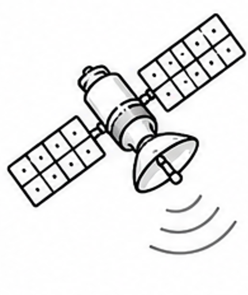{width="40"} | Passive reception of reflected global navigation satellite systems (GNSS) signals or natural microwave emissions in the L-band (e.g., \~1.5 GHz). | Estimate of surface reflectivity, signal attenuation correlated with the dielectric constant of the soil. | **Benefit:** Ability to penetrate cloud cover and partially vegetation cover (to a depth of \~50 mm).<br>**Limits:** The signal is strongly distorted by surface roughness and biomass structure. | [@Farhad2025; @Senyurek2022; @Wang2026; @Ye2024] |
| **Geophysical & Nuclear** <br>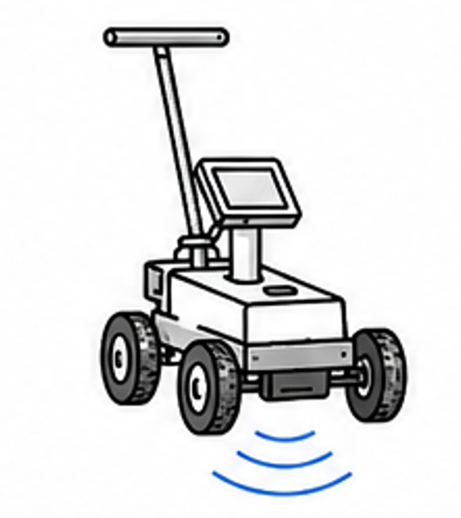{width="40"} 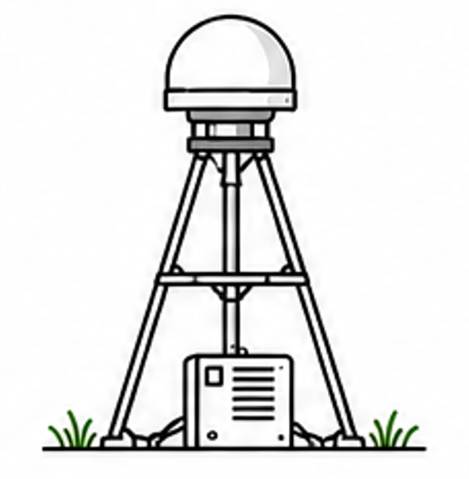{width="40"} | Active transmission of electromagnetic pulses or passive detection of epithermal neutrons. | Attenuation of radar signal, area-averaged hydrogen content in the soil profile. | **Benefit:** Non-destructive measurement of bulk moisture deeper than optical/TIR (GPR profile of the root zone; CRNS ~10–50 cm, hectare footprint).<!-- opraveno AI, schváleno (kluci, 20. 11. 2026). Původní: deeper soil horizons. Nové: GPR root-zone profile; CRNS ~10–50 cm, hectare footprint (čísla z odstavce pod tabulkou). --><br>**Limits:** Extreme spatial data integration (large footprint for CRNS), demanding calibration for local hydrogen pools. | [@Heistermann2023] |

: Classification and operational characteristics of sensors utilized for
soil moisture estimation (2019–2026). The complete classification of all
sensor modalities encountered in the reviewed studies is given in
@or-sensors. {#tbl-sensors}

The sensors in @tbl-sensors fall into two groups: those that infer soil
moisture from vegetation or surface proxies, and those that respond to
dielectric permittivity or hydrogen in the soil.

Passive optical (MS and HS) and TIR sensors can provide proxy information
on canopy and surface state but do not allow for the direct measurement of soil moisture
in the soil profile beneath vegetation [@Bhatti2020; @Yin2024]. Instead,
they capture structural, biochemical, and thermodynamic responses of the
vegetation cover. MS and HS sensors monitor reflectance changes caused
by chlorophyll and water absorption bands in plants, while TIR sensors
record land surface temperature (LST) as an indicator of evaporative
cooling (transpiration) [@BasurtoLozada2020; @Chu2026; @Shokati2025].
These passive methods are limited to the surface layer of
vegetation or the top layer of bare soil and are highly sensitive to
varying atmospheric and lighting conditions [@Chavez2020;
@Inocencio2025].

Dielectric-based sensing techniques, including GNSS-R and GPR, exploit the primary control
of soil volumetric water content on complex dielectric permittivity
[@Farhad2025; @Zajc2023]. Specifically, L-band GNSS-R measures bistatic
specular reflections sensitive to topsoil moisture (0–5 cm depth) while
demonstrating robust permeability through cloud cover and moderate crop
canopies [@Farhad2025; @Senyurek2022; @Wang2026]. Conversely, GPR and
ultra-wideband (UWB) systems evaluate electromagnetic wave propagation
velocity and signal attenuation across root-zone profiles [@Guo2022;
@Zajc2023].
<!-- opraveno AI, schváleno (kluci, 20. 11. 2026).
     Původní: across vertical soil profiles
     Nové: across root-zone profiles (hloubka CRNS 10–50 cm už je ve větě za tím). --> Operating on a distinct physical mechanism, CRNS quantifies soil water content across
hectare-scale footprints (10–50 cm depth) by measuring the moderation of
naturally occurring fast neutrons by ambient hydrogen atoms
[@Dopper2022; @Heistermann2023]. Although UAV-based GNSS-R and radar
systems offer high spatial resolution at the field scale,
satellite-based reflectometry requires spatial disaggregation
[@Wang2026], whereas footprint-integrated methods like CRNS trade
spatial granularity for continuous root-zone coverage and require
rigorous local calibration [@Heistermann2023].

<!-- TEXT QUALITY: Precision Agriculture 5.0 pryč. Teď: Several of the
     reviewed studies fuse data from multiple sensors (Capolupo / Zhang).
     Druhá věta o kombinacích (Du / Niu / Shi) zůstala. -->
Several of the reviewed studies fuse data from multiple
sensors [@Capolupo2026; @Zhang2023]. Sensor combinations—such as using
high-resolution MS data to refine (downscale) dielectric property
estimates derived from microwave measurements, or integrating surface
temperature (TIR) with vegetation indices to calculate water stress
indices (e.g., CWSI, TVDI)—thus compensate for the limitations of
individual methods [@Du2024; @Niu2025; @Shi2025].
<!-- NÁVRH (kluci + TEXT QUALITY): pojem Precision Agriculture 5.0 vyhodit.
     Stačí: Several of the reviewed studies therefore fuse sensors rather
     than relying on one — nechat Capolupo / Zhang / Du. Dichotomii výše
     nenechávat jako tezi o dvou citacích; přeformulovat na popis Table 5.
     Detailed → proxy information. Hloubku GPR/CRNS (10–50 cm) už máte v
     dalším odstavci — do tabulky Geophysical doplnit čísla. -->

### Drone studies

<!-- Author: Jiří Rous -->

<!-- Status: Done  -->

<!-- Pangram test: 100 % AI -->

<!-- TEXT QUALITY: NECHAT — TIR overlap, HS integrační čas, nízký let GNSS-R/LiDAR, ASPRS čísla v Table 7. TIR odstavce z Trends Conclusions (warm-up, NRCT, pixel mixing) jsou sem přesunuté. -->

While multi-sensor fusion is physically robust, its operational
implementation is strictly constrained by the payload capacity and
energy budgets of UAV platforms. Three primary airframes govern these
operational boundaries: multi-rotors, which offer vertical takeoff and
hovering but limited endurance; fixed-wings, which extend range but
require larger takeoff areas; and hybrid VTOLs, which combine vertical
takeoff with winged flight efficiency at the expense of payload
[@Chavez2020]. Crucially, while the airframe determines the operational
flight envelope, the spectral depth and data quality are governed by the
on board sensors rather than the carrier platform itself [@Capolupo2026;
@GarciaRodriguez2026].

<!-- Zapracováno @Guo2026 do References u RGB & Multispectral (@tbl-uav; 60 m, GSD 3,2 cm, 75/75). -->
| Primary Payload | Altitude \[m\] | Spatial Resolution (GSD) \[mm\] | Overlap (Front/Side) \[%\] | Representative References |
|:--------------|:--------------|:--------------|:--------------|:--------------|
| **RGB & Multispectral** <br> {width="40"} {width="40"} | 20 – 70 | 4 – 50 | 75–85 / 70–80 | [@Chakhar2021; @Chen2024; @Guo2026; @He2025] |
| **Thermal Infrared (TIR)** <br> {width="40"} | 15 – 70 | 19 – 90 | 80–85 / 70–80 | [@Tauro2022; @Yin2024; @Zhang2023] |
| **Hyperspectral (HS)** <br> {width="40"} | 25 – 100 | 10 – 40 | 70–80 / 70 | [@Dopper2022; @Liu2024; @Shokati2025] |
| **GNSS-R & LiDAR** <br> {width="40"} {width="40"} | 15 – 30 | 50 – 80 (grid) | 75 / 75 | [@Farhad2025; @Rafi2026] |

: Synthesized operational envelopes of UAV-based missions categorized by
primary sensor payloads. For a detailed specification of individual
flight campaigns, see @or-uav. {#tbl-uav}

The operational flight configurations of UAV missions are intrinsically
linked to the physical and radiometric constraints of their primary
sensor payloads (@tbl-uav). For RGB and multispectral mapping, high
<!-- opraveno AI, schváleno (kluci, 20. 11. 2026).
     Původní: For optical and multispectral mapping
     Nové: For RGB and multispectral mapping (MS je optika, neoddělovat). -->
front and side overlaps are required to guarantee a dense distribution
of geometric keypoints, which is essential for stable photogrammetric
reconstruction (Structure from Motion, SfM) of complex, heterogeneous
crop canopies [@Chakhar2021; @Chen2024; @He2025].

In contrast, thermal infrared (TIR) mapping demands even larger overlap
margins despite its inherently coarser spatial resolution. This
requirement is physically dictated by the need to compensate for the low
radiometric contrast and spatial noise characteristic of uncooled
microbolometers, which would otherwise result in feature-matching and
image-stitching failures [@Tauro2022; @Yin2024; @Zhang2023].

<!-- PŘESUNUTO sem z Trends Conclusions (JR TIR). -->

Recent studies have examined the use of UAV-based TIR
remote sensing for soil moisture modelling and crop water stress
detection [@Tauro2022; @Niu2022]. These studies report relationships
between thermally derived indicators, including the crop water stress
index (CWSI), evapotranspiration, and soil moisture conditions. At the
same time, several authors identify limitations related to temperature
measurement accuracy, meteorological conditions, and flight
configuration [@Chavez2020].

Temperature measurement accuracy is frequently discussed in relation to
the use of uncooled microbolometers. Thermal drift during flight has
been reported as a potential source of error in absolute temperature
measurements [@Chavez2020; @Yin2024]. Proposed approaches to reduce this
effect include pre-flight sensor stabilisation and the use of
ground-based calibration targets [@Chavez2020; @BasurtoLozada2020].
Other studies have used relative thermal indicators, such as the
normalised relative canopy temperature (NRCT), to reduce sensitivity to
environmental variability [@Yin2024; @Chu2026].

Meteorological conditions are another frequently reported source of
variability in TIR measurements. Atmospheric effects may increase with
flight altitude, while wind speed, relative humidity, and solar
radiation can influence the recorded thermal signal [@BasurtoLozada2020;
@Capolupo2026]. However, these variables are not consistently
incorporated into retrieval models across the reviewed studies.

Flight altitude and speed are also reported as important operational
parameters. The lower spatial resolution of thermal cameras compared
with optical sensors can increase mixed-pixel effects at greater flight
altitudes [@Chavez2020; @Bhatti2020]. This may complicate the separation
of canopy and soil temperatures [@Tauro2022]. Flight speed is
additionally constrained by sensor acquisition characteristics and the
image overlap required for thermal orthomosaic generation [@Chavez2020].

The reviewed studies propose several directions for addressing these
limitations. These include more consistent radiometric calibration
procedures [@Chavez2020] and the integration of TIR data with
multispectral imagery or 3D LiDAR data to improve the separation of
vegetation and soil signals [@Dopper2022; @Shi2025].

For hyperspectral missions, flight parameters must carefully balance
sensor integration times with the UAV's ground speed to prevent spatial
stretching, geometric distortion, and band-misregistration across the
narrow-band data cubes [@Dopper2022; @Liu2024; @Shokati2025].

Finally, active LiDAR and specialized GNSS-R missions operate within a
restricted low-altitude envelope to maximize signal-to-noise ratios and
return strength, ensuring accurate 3D structural modeling and specular
soil reflectivity measurements [@Farhad2025; @Rafi2026].

<!-- Zapracováno @Guo2026: přepočet N = 46 (22. 11. 2026). -->
| Domain / Category | Detailed Tracked Sub-Parameter | Fully Reported (n / 46) | Partially Reported (n / 46) | Omitted (n / 46) | Full Reporting Rate (%) |
|:-----------|:-----------|:----------:|:----------:|:----------:|:----------:|
| **2. Sensor specification** | Sensor Matrix Resolution, Lens & Focal Length | 29 / 46 | 17 / 46 | 0 / 46 | [**63.0%**]{style="color: #66A61E;"} |
| **3. Flight & acquisition settings** | Acquisition Interval, Flight Time & Solar Illumination | 29 / 46 | 2 / 46 | 15 / 46 | [**63.0%**]{style="color: #66A61E;"} |
|  | Flight Speed & Pattern (Grid, Double-grid, Transect) | 22 / 46 | 22 / 46 | 2 / 46 | [**47.8%**]{style="color: #E69F00;"} |
|  | Camera Pitch Angle (Nadir 90° vs. Oblique) | 18 / 46 | 26 / 46 | 2 / 46 | [**39.1%**]{style="color: #E69F00;"} |
| **4. Data/output characteristics** | Pixel Size, Bit Depth & Total Image Count | 33 / 46 | 11 / 46 | 2 / 46 | [**71.7%**]{style="color: #66A61E;"} |
| **5. Data processing specification** | GCP Survey Accuracy & Equipment (RTK-GNSS/DGPS) | 34 / 46 | 11 / 46 | 1 / 46 | [**73.9%**]{style="color: #66A61E;"} |
|  | Radiometric Calibration (Panel / Downwelling Sensor) | 30 / 46 | 10 / 46 | 6 / 46 | [**65.2%**]{style="color: #66A61E;"} |
| **6. ASPRS 2024 Geodetic Accuracy** | Horizontal Accuracy Class (RMSE_H) | 30 / 46 | 0 / 46 | 16 / 46 | [**65.2%**]{style="color: #66A61E;"} |
|  | Vertical Accuracy Class (RMSE_V / NVA / VVA) | 7 / 46 | 0 / 46 | 39 / 46 | [**15.2%**]{style="color: #F8696B;"} |
|  | 3D Positional Accuracy (RMSE_3D) | 4 / 46 | 0 / 46 | 42 / 46 | [**8.7%**]{style="color: #F8696B;"} |
|  | Checkpoint Sample Size (ASPRS N \>= 30) | 0 / 46 | 30 / 46 | 16 / 46 | [**0.0%**]{style="color: #F8696B;"} |
|  | ASPRS 2024 Full Compliance Statement | 0 / 46 | 30 / 46 | 16 / 46 | [**0.0%**]{style="color: #F8696B;"} |

```{=html}
<!-- METADATA: Červená 0 % u N≥30 a Full Compliance je Layer 3 (ASPRS),
     ne Layer 1. V legendě/barvách to teď vypadá jako metodologické
     selhání. Buď přebarvit, nebo pod tabulku dát větu z odstavce ASPRS. -->
```

: Methodological Completeness of All Tracked Sub-Parameters. Complete
state of Sub-Parameters for each individual study are given in
@or-uav-param. {#tbl-uav-param}
<!-- opraveno AI, schváleno (kluci, 20. 11. 2026).
     Původní: tabulka začíná „2. Sensor specification“ bez skupiny 1.
     Nové: Numbering follows the original audit groups; group 1
     (site/platform) is in Table 8. -->
Numbering follows the original audit groups; group 1 (site and platform)
is reported in @tbl-uav-param-core.

```{=html}
<!-- METADATA: Table 8 = 25 položek Layer 1 (stejné jako OR 16 / checklist).
     Vyhozeno: mission_id, focal length, solar geometry, adjustment_quality,
     RMSE_V, ASPRS full compliance, celá SM kategorie 12 (to je modul OR 17).
     L1-01 a L1-02 sdílejí jeden kód spatial_temporal_extent (12/19/15).
     L1-11 a L1-12 sdílejí overlap front/side (37/3/6).
     L1-03 start_utc je z Table 7 (flight time / illumination 29/2/15).
     L1-10 flight_pattern je z Table 7 (speed & pattern 22/22/2).
     L1-19 checkpoint_count je původní skóre ASPRS N≥30 (0/30/16), ne „bylo N uvedeno“.
     L1-23 known_issues v auditu 46 studií nebylo kódováno.
     Přepočet N = 46 po @Guo2026 (22. 11. 2026). -->
```

| ID | Item | Key | Fully Reported (n / 46) | Partially Reported (n / 46) | Omitted (n / 46) | Full Reporting Rate (%) |
|:----------|:----------|:----------|:---------:|:---------:|:---------:|:---------:|
| L1-01 | Site bounding box or centroid | `spatial_extent` | 12 / 46 | 19 / 46 | 15 / 46 | [**26.1%**]{style="color: #F8696B;"} |
| L1-02 | Acquisition window (ISO 8601, UTC) | `temporal_extent` | 12 / 46 | 19 / 46 | 15 / 46 | [**26.1%**]{style="color: #F8696B;"} |
| L1-03 | Mission start and end (UTC) | `start_utc` | 29 / 46 | 2 / 46 | 15 / 46 | [**63.0%**]{style="color: #66A61E;"} |
| L1-04 | UAV manufacturer and model | `platform_model` | 46 / 46 | 0 / 46 | 0 / 46 | [**100.0%**]{style="color: #66A61E;"} |
| L1-05 | Sensor type | `sensor_type` | 46 / 46 | 0 / 46 | 0 / 46 | [**100.0%**]{style="color: #66A61E;"} |
| L1-06 | Exact payload model | `sensor_model` | 40 / 46 | 6 / 46 | 0 / 46 | [**87.0%**]{style="color: #66A61E;"} |
| L1-07 | Band names / centre wavelengths | `bands` | 37 / 46 | 9 / 46 | 0 / 46 | [**80.4%**]{style="color: #66A61E;"} |
| L1-08 | Planned altitude (m AGL) | `nominal_agl` | 46 / 46 | 0 / 46 | 0 / 46 | [**100.0%**]{style="color: #66A61E;"} |
| L1-09 | GNSS mode | `gnss_mode` | 46 / 46 | 0 / 46 | 0 / 46 | [**100.0%**]{style="color: #66A61E;"} |
| L1-10 | Flight pattern | `flight_pattern` | 22 / 46 | 22 / 46 | 2 / 46 | [**47.8%**]{style="color: #E69F00;"} |
| L1-11 | Front overlap | `overlap_forward` | 37 / 46 | 3 / 46 | 6 / 46 | [**80.4%**]{style="color: #66A61E;"} |
| L1-12 | Side overlap | `overlap_side` | 37 / 46 | 3 / 46 | 6 / 46 | [**80.4%**]{style="color: #66A61E;"} |
| L1-13 | Nominal GSD | `gsd_nominal` | 46 / 46 | 0 / 46 | 0 / 46 | [**100.0%**]{style="color: #66A61E;"} |
| L1-14 | Radiometric calibration (panel / DLS) | `panel_reflectance` | 30 / 46 | 10 / 46 | 6 / 46 | [**65.2%**]{style="color: #66A61E;"} |
| L1-15 | Thermal drift / FFC / warm-up | `drift_protocol` | 8 / 46 | 12 / 46 | 26 / 46 | [**17.4%**]{style="color: #F8696B;"} |
| L1-16 | Lens distortion model | `distortion_model` | 18 / 46 | 26 / 46 | 2 / 46 | [**39.1%**]{style="color: #E69F00;"} |
| L1-17 | Processing software and version | `software` | 42 / 46 | 4 / 46 | 0 / 46 | [**91.3%**]{style="color: #66A61E;"} |
| L1-18 | GCP survey method, or direct georef | `gcp_survey_method` | 42 / 46 | 3 / 46 | 1 / 46 | [**91.3%**]{style="color: #66A61E;"} |
| L1-19 | Independent checkpoint count *N* | `checkpoint_count` | 0 / 46 | 30 / 46 | 16 / 46 | [**0.0%**]{style="color: #F8696B;"} |
| L1-20 | Horizontal RMSE if map geometry claimed | `reported_rmse_horizontal` | 30 / 46 | 0 / 46 | 16 / 46 | [**65.2%**]{style="color: #66A61E;"} |
| L1-21 | Dataset DOI or persistent URL | `dataset_id` | 5 / 46 | 0 / 46 | 41 / 46 | [**10.9%**]{style="color: #F8696B;"} |
| L1-22 | Dataset licence | `licence` | 6 / 46 | 0 / 46 | 40 / 46 | [**13.0%**]{style="color: #F8696B;"} |
| L1-23 | Known issues / artefacts | `known_issues` | — | — | — | — |
| L1-24 | Weather source | `weather_source` | 29 / 46 | 2 / 46 | 15 / 46 | [**63.0%**]{style="color: #66A61E;"} |
| L1-25 | Product type | `product_type` | 46 / 46 | 0 / 46 | 0 / 46 | [**100.0%**]{style="color: #66A61E;"} |

: Reporting completeness of the 25 Layer 1 paper-checklist items across
`{r} stats_r['n_studies']` studies. Per-study detail is given in @or-uav-param-core.
{#tbl-uav-param-core}

<!-- uvest jen ty, co nejsou zelene; ostatni odkaz OR; zvlast Soil Moisture Target Application - samostatna tabulka -->

<!-- Status: Done  -->

<!-- Pangram test: 100 % Human Written -->

```{=html}
<!-- METADATA — DOPLNIT do tohoto odstavce (tělo neměnit, dokud to nenapíšete
     sama). ASPRS 2024 je geodetická norma pro digitální geospatial produkty,
     ne reporting guideline pro článek. Tři formy: Tested to Meet (N≥30 a
     tvrzená accuracy class); Tested with Reduced Checkpoints (většina
     výzkumných pozemků — RMSE lze uvést, N<30); Produced to Meet (navrženo
     na třídu, test nedokončen). RMSE_H = ortomozaika/reflectance; NVA/VVA a
     3D RMSE = výškový produkt. Žádná z forem není podmínkou publikace
     SM studie, pokud autoři netvrdí mapovou třídu přesnosti. -->
```

<!-- opraveno AI, schváleno (METADATA + Lenka, 20. 11. 2026).
     Původní: Based on these two frameworks, we evaluated…
     Nové: ASPRS = geodetický odkaz, ne druhý checklist; skóre = 25
     Layer 1 z OpenSkyLab (@tbl-uav-param-core). N≥30 je v odstavci pod tím. -->
The American Society for Photogrammetry and Remote Sensing (ASPRS)
published the [ASPRS Positional Accuracy Standards for Digital
Geospatial Data (Edition 2, Version 2.0,
2024)](https://www.asprs.org/Main/Main/Standards/Positional-Accuracy-Standards.aspx)
[@ASPRS2024]. We cite that standard as a geodetic reference, not as a
second reporting checklist. Reporting was evaluated against 25 Layer 1
items drawn from the OpenSkyLab [metadata
specification](https://openskylab.space/data.html#template) at the
Faculty of Environmental Sciences, Czech University of Life Sciences
Prague (@tbl-uav-param-core, @or-uav-param-core). Across the
`{r} stats_r['n_studies']` studies, basic information about the UAV
platform, flight settings, sensors, and soil moisture modelling was
consistently reported. Several core parameters were available in all
studies. These included UAV type, flight altitude, sensor type, nominal
GSD, target soil moisture variable, reference measurements, modelling
approach, and accuracy metrics. Other practical details, such as soil
sampling depth, GCP survey procedures, photogrammetric software, sensor
specifications, image overlap, and spectral bands, were also reported in
most cases.

```{=html}
<!-- METADATA/ASPRS: Přepsat, ať 0 % u N≥30 není „selhání článku“. Je to
     očekávané u výzkumných pozemků (Tested with Reduced Checkpoints).
     DOI 11 % a licence 13 % jsou Layer 2 (dataset), ne Layer 1 (paper).
     Tepelný drift 18 % naopak v Layer 1 zůstat má (L1-15, jen TIR).
     Poslední věta „12 metadata categories“ odkazuje na audit Table 8,
     ne na tištěné OR 16 (teď 25 položek). -->
```

<!-- opraveno AI, schváleno (kluci + METADATA, 20. 11. 2026; večer sloučeno).
     Původní: None … met the ASPRS N≥30 requirement; 12 metadata categories;
     potom duplicitní seznam % včetně DOI/licence jako selhání paperu.
     Nové: dírý v Layer 1 bez procent (až po běhu); N≥30 jen u mapové třídy;
     DOI/licence = dataset, ne checklist článku. -->
Reporting was less consistent for campaign extent, TIR calibration, and
geodetic quality control. Spatial and temporal extent, TIR drift protocol,
lens distortion, and flight pattern were often missing. None of the
reviewed studies reported 30 independent checkpoints; that ASPRS
threshold applies when a map accuracy class is claimed, not as a
requirement of every soil-moisture paper. Dataset DOIs and open licences
describe the published data package rather than the paper checklist. The
25 Layer 1 items are in @tbl-uav-param-core and @or-uav-param-core.
<!-- KAM (není v tištěném textu; 0/45 až po běhu pipeline):
     sem, za odstavec o reportingu 45 studií (@tbl-uav-param-core).
     Je to výsledek auditu must-cite, ne metodika tohoto review.
     Do Review Methodology NEDÁVAT — tam je neregistrovaný PRISMA-P
     *tohoto* článku; smíchalo by se to s 0/45 u studií.
     Discussion (Limitations / Implications) eventualně jedna věta odkazem
     sem, čísla neopakovat.
     ČÍSLA 0/45, 7/45 (15,6 %), 38/45 (84,4 %) předběžná — srovnat až
     po dalším běhu pipeline z runneru.

     SPOJIT s odstavcem NAD tím (česky, upravíte):
     Chybějící extent, TIR drift a DOI říkají, co v paperu není. Stejně
     důležité je, zda byla metoda v textu doložena jako předem daná,
     nebo jen popsána až po sběru.

     VLOŽIT (kódováno z uveřejněného článku, ne z toho, zda protokol
     v šuplíku existoval — nepsat „nepostupovala podle“ ani „dokládá,
     že obor neadoptoval registraci“):
     Co se týče metodologické transparentnosti a reprodukovatelnosti,
     žádná z 45 studií (0,0 %, n = 0 / 45) v uveřejněném textu
     nedoložila veřejně registrovaný, časově orazítkovaný a priori
     protokol (Registered Reports, pre-registrace). Sedm prací (15,6 %,
     n = 7 / 45) explicitně uvedlo standardizované operační rámce,
     kalibraci výrobce nebo směrnice pro terénní odběr [@Chakhar2021;
     @Chavez2020; @Dopper2022; @Heistermann2023; @Inocencio2025;
     @Shi2025; @Zhuang2023]. Naprostá většina (84,4 %, n = 38 / 45)
     popisovala metody striktně retrospektivně. To není důkaz, že
     v terénu protokol neexistoval — hodnoceno bylo uveřejnění v článku.
     Bez veřejně ověřitelného popisu však nelze nezávisle posoudit
     selektivní reporting ani dodatečné úpravy postupu.

     Sedm studií = v textu citovaly standard / kalibraci výrobce /
     směrnici odběru, to není Registered Report.

     SPOJIT s tím, co PŘIJDE dál (česky, upravíte):
     Checklist v Conclusion proto žádá uveřejnit minimum údajů. Zda TIR
     k cíli patřil, z retrospektivního popisu často nejde posoudit.
     Další kapitola (Applications) už je o plodinách a modelech — proto
     tento odstavec nechat tady, před čarou, ne až za ní. -->

------------------------------------------------------------------------

## Applications and Methods {.unnumbered}

### Inputs Variables and Layers {.unnumbered}

<!-- Author: Lenka Mikova -->

<!-- Status: Done  -->

<!-- Pangram test: x % human / x % AI / x % asistent AI -->

As summarized in @tbl-inputs, soil moisture estimation relies on various
input data types. Instead of measuring soil water content directly,
these parameters capture the indirect response of vegetation and the
land surface to water availability. MS and RGB data enter as NDVI, 
EVI or NDRE and as fraction of vegetation cover [@Chen2024; @Shi2025;
@Yin2024]. Hyperspectral retrievals use narrow water-absorption
bands [@Dopper2022; @Shokati2025]. Thermal retrievals use LST and CWSI or 
TVDI [@BasurtoLozada2020; @Chu2026; @Tauro2022].

The microwave input is VV/VH backscatter or a dielectric estimate [@Chakhar2021; 
@Farhad2025]. GNSS-R studies use L-band reflectivity [@Farhad2025; @Senyurek2022; @Wang2026].

These spectral observations are often complemented by structural and
environmental data. <!-- opraveno AI, schváleno (kluci / TEXT QUALITY, 20. 11. 2026).
     Původní: Canopy Hight Model) ans DSM
     Nové: Canopy Height Model) and DSM -->
LiDAR is used as CHM (Canopy Height Model) and DSM (Digital Surface Model).
[@Farhad2025; @Feng2025; @Rafi2026]. Additionally, weather stations and
in-situ sensors—measuring variables such as temperature, humidity, and
sap flow—provide continuous ground-truth data for model calibration
[@Choudhari2024; @GarciaRodriguez2026; @Soultane2024].

<!-- Zapracováno @Guo2026 do References u MS & RGB (@tbl-inputs). -->
| Input Modality | Key Derived Variables & Layers | Primary Utility in SMC Estimation | Representative References |
|:-----------------|:-----------------|:-----------------|:-----------------|
| **Multispectral (MS) & RGB** <br> {width="40"} {width="40"} | VIs (NDVI, EVI, NDRE), FVC, textural features (GLCM). | Proximal proxy for vegetation water status and 2D canopy traits. | [@Chen2024; @Guo2026; @Shi2025; @Yin2024] |
| **Thermal Infrared (TIR)** <br> {width="40"} | LST, CWSI, TVDI, thermal inertia. | Direct linkage to evapotranspiration and surface energy balance. | [@BasurtoLozada2020; @Chu2026; @Tauro2022] |
| **Hyperspectral (HS)** <br> {width="40"} | Narrowband derivatives, specific water absorption bands, 1D/2D Savitzky-Golay. <!-- SIF-->| Deep physiological diagnostics; mitigation of background noise and canopy occlusion. | [@Dopper2022; @Zhang2025] |
| **Microwave & SAR** <br> {width="40"} {width="40"} | Surface dielectric constant, backscatter coefficients (VV, VH), GNSS-R signals. | Dielectric constant and VV/VH backscatter as the soil-moisture-sensitive input.<!-- opraveno AI, schváleno (kluci, 20. 11. 2026). Původní: High penetration capability through clouds and partial canopy cover. Nové: utility = dielektrikum / backscatter; penetrace oblaků patří do Table 5. --> | [@Chakhar2021; @Farhad2025] |
| **LiDAR & 3D Point Clouds** <br> {width="40"} | Canopy Height Model (CHM), DSM, spatial point cloud metrics (entropy, kurtosis). | Precise 3D characterization of canopy architecture and topographic correction. | [@Farhad2025; @Feng2025; @Rafi2026] |
| **In-situ IoT & Meteorological** <br>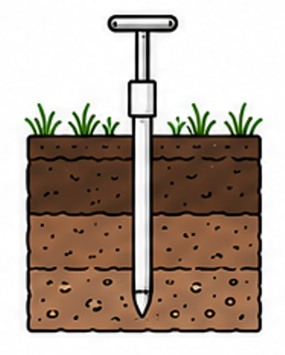{width="40"} | Sap flow, ambient temperature, humidity, local weather forcing. | Real-time temporal synchronization, edge-computing, and continuous local calibration. | [@Choudhari2024; @GarciaRodriguez2026; @Soultane2024] |

: Overview of primary input data modalities, extracted variables, and
their specific utility in soil moisture retrieval. Sensor
specifications, data fusion strategies, and ground-truth references for
each individual study are given in @or-inputs. {#tbl-inputs}


In practice, ground-truth validation strategies vary significantly
across the reviewed studies. While several campaigns rely on the
standard gravimetric oven-drying method [@Chen2024; @Liu2026;
@Zhang2023], others utilize in-situ electromagnetic sensors (such as FDR
or TDR probes) at depths ranging from the top 5 cm to 60 cm
[@Chakhar2021; @Chu2026; @Tauro2022]. Additionally, some models are
validated against plant-based proxies, such as sap flow or final crop
yield, rather than direct soil moisture measurements [@Chavez2020;
@Hussain2025].

------------------------------------------------------------------------

### Applications {.unnumbered}

<!-- Author: Lenka Mikova -->

<!-- Status: TODO  -->

<!-- Pangram test: x % human / x % AI / x % asistent AI -->

<!-- TEXT QUALITY: NECHAT. Chakhar (IEM+WCM), Shokati (holá půda vs. porost), Dopper (thatch / PROSAIL). Úvodní „vary significantly“ zkrátit, zbytek je nejlepší část těla. -->
<!-- NÁVRH: kapitola není prázdná — neřezat Shokati / Chakhar / Dopper.
     Jen rozdělit dlouhou větu o cibuli a Dopper u thatch uvést jednou. -->

<!-- Zapracováno @Guo2026 do References u Arable Crops (@tbl-applications). -->
| Target Application | Specific Crops / Land Cover | Key Challenges for SMC Retrieval | Applicability & Feasibility | Representative References |
|:--------------|:--------------|:--------------|:--------------|:--------------|
| **Bare Soil** <br>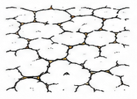{width="60"} 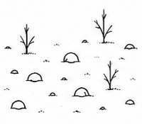{width="60"} | Uncultivated fields, ploughed seedbeds, lab samples. | Surface roughness and topographic heterogeneity influencing surface reflectance. | **High:** Direct retrieval is feasible; highly accurate for both physically-based and data-driven models. | [@Chakhar2021; @Shokati2025; @Zhang2025] |
| **Arable Crops** <br>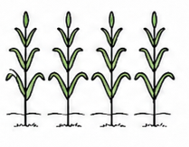{width="60"} 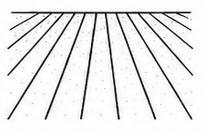{width="60"} | Maize, winter wheat, cotton, soybean, canola. | Dynamic canopy occlusion and varying phenological stages throughout the season. | **Moderate to High:** Highly dependent on growth stage; requires multi-sensor fusion to mitigate canopy background noise. | [@Chu2026; @Guo2026; @He2025; @Liu2024] |
| **Orchards & Vineyards** <br>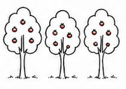{width="60"} 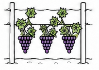{width="60"} | Citrus, pomegranate, poplar, vineyards. | Complex 3D architecture, shading effects, and inter-row bare soil mixing. | **Moderate:** Feasible but complex; requires 3D shadow compensation, pure-pixel extraction, or energy balance approaches. | [@Chandel2021; @Liu2026; @Niu2022] |
| **Grasslands & Pastures** <br>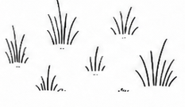{width="60"} 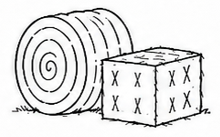{width="60"} | Mown, grazed, and permanent pastures. | Thatch layer accumulation and rapid temporal alteration of plant traits. | **Moderate to Low:** Heavily hampered by dead biomass; necessitates complex radiative transfer models (RTMs) to decouple the signal. | [@Dopper2022; @Ye2024] |

: Categorization of soil moisture monitoring applications across
different land cover types, associated physical challenges, and overall
retrieval feasibility. Crops, phenological stages, local interferences,
and spatial scales of the individual studies are given in
@or-applications. {#tbl-applications}

<!-- opraveno AI, schváleno (kluci / TEXT QUALITY, 20. 11. 2026).
     Původní: vary significantly across different agricultural land cover types
     Nové: vary across land-cover types (bez significantly). -->
SMC retrieval accuracy and operational feasibility vary across land-cover
types (@tbl-applications). Over
bare soils, estimation models typically exhibit high precision due to
the absence of vegetation-induced signal distortion and canopy
shadowing. Under these conditions, surface roughness and
micro-topographic variations represent the primary physical confounding
factors. Specifically, @Shokati2025 demonstrated that various machine
learning algorithms consistently yield superior SMC prediction accuracy
over bare soils compared to cultivated fields or grasslands. Similarly,
early-season flight campaigns over uncultivated land allow the direct
observation of spectral and thermal contrasts associated with soil
drainage and moisture anomalies, which are subsequently obscured as the
crop canopy develops [@Zajc2023]. For active microwave sensing, the
absence of vegetation simplifies backscatter modeling by eliminating
canopy volume scattering; physically-based approaches, such as the
Integral Equation Model (IEM), can thus be applied directly to retrieve
surface soil moisture without the need for vegetation corrections
[@Chakhar2021]. Under bare soil conditions, radar backscatter is
governed strictly by the soil's dielectric properties and surface
roughness, stabilizing model inversion [@Chakhar2021; @Shokati2025].

For arable croplands, soil moisture retrieval becomes more complex due
to rapid canopy development and phenological changes throughout the
growing season [@Chen2024; @Chu2026; @Du2024]. To mitigate canopy
interference and capture these highly dynamic states, modern frameworks
increasingly rely on multi-source data fusion [@Chu2026; @He2025;
@Liu2024]. The physical limitations of modeling dynamically developing
crop canopies are well illustrated by @Chakhar2021 using a combined IEM
and Water Cloud Model (WCM) framework. <!-- opraveno AI, schváleno (kluci, 20. 11. 2026).
     Původní: jedna dlouhá věta od barley/pea až po dense onion canopies
     / volume scattering.
     Nové: (1) IEM+WCM drží v raných fázích. (2) Po zapojení porostu,
     zvlášť hustá cibule, C-pásmo přestane vidět půdu. -->
While the combined model reliably estimates soil moisture during early
phenological stages (such as barley stem elongation or early pea leaf
development), subsequent canopy closure and aboveground biomass
accumulation cause severe C-band microwave attenuation. In dense onion
canopies, volume scattering within the vegetation layer dominates the
radar signal and the C-band return no longer tracks soil moisture
[@Chakhar2021].

In woody crops, such as orchards and vineyards, different structural
challenges arise. The complex 3D architecture of these stands introduces
pronounced canopy shadowing and leads to mixed pixels containing both
tree crowns and bare soil, which complicates radiometric calibration
[@Chandel2021; @Liu2026; @Niu2022]. Similarly, soil moisture retrieval
over grasslands is heavily hampered by rapid biomass turnover and the
accumulation of a dead organic layer (thatch) [@Ye2024].
<!-- opraveno AI, schváleno (kluci, 20. 11. 2026).
     Původní: thatch [@Dopper2022; @Ye2024]. Specifically, @Dopper2022
     demonstrated… conditions [@Dopper2022].
     Nové: Ye2024 u thatch; PROSAIL/LAI jen s Dopper jednou. -->
@Dopper2022 showed that physically-based retrieval of the soil brightness
factor via PROSAIL inversion is only viable at low leaf area index (LAI)
and without a thatch layer, which in permanent grasslands completely
obscures the soil surface.

------------------------------------------------------------------------

### Methods {.unnumbered}

<!-- Author: Lenka Mikova -->

<!-- Status: TODO  -->

<!-- Pangram test: x % human / x % AI / x % asistent AI -->

<!-- Zapracováno @Guo2026 do References u ML & Ensembles (@tbl-methods; GCA + RF). -->
| Methodological Approach | Specific Algorithms / Models | Typical Validation Accuracy | Representative References |
|:-----------------|:-----------------|:-----------------|:-----------------|
| **Machine Learning (ML) & Ensembles** | RF, SVM, XGBoost, PLSR, Stacking Ensembles. | High (R²: 0.70–0.97); robust for multi-sensor data fusion but prone to overfitting. | [@Chu2026; @Feng2025; @Guo2026; @Yin2024] |
| **Deep Learning (DL)** | 1D-CNN, LSTM, BPNN, Attention Mechanisms. | Very High (R²: \> 0.90); excels in modeling complex non-linear time-series relationships. | [@He2026; @Liu2026; @Zhang2025] |
| **Physical & Energy Balance** | TSEB, SEBAL, METRIC. | Moderate to High; absolute dependence on accurate meteorological forcing data. | [@BasurtoLozada2020; @Chandel2021; @Tauro2022] |
| **Radiative Transfer & Hybrid Models** | PROSAIL, OPTRAM, WCM, MARMIT. | Variable (R²: 0.40–0.84); physically interpretable but inversion process is computationally complex. | [@Chakhar2021; @Dopper2022; @Du2024] |

: Synthesis of principal analytical methodologies applied for soil
moisture estimation and their typical performance metrics. Algorithms,
inputs, and reported accuracies of the individual studies are given in
@or-methods. {#tbl-methods}

Methods for estimating SMC range from empirical, data-driven algorithms
to physically-based models (@tbl-methods).
<!-- opraveno AI, schváleno (kluci, 20. 11. 2026).
     Původní: pod tabulkou jen tato věta (učebnicové highly flexible /
     overfitting / black-box už pryč).
     Nové: jeden odstavec energie (TSEB/SEBAL/METRIC) a RTM (PROSAIL/WCM/MARMIT)
     z českého nástřelu. -->
The table also includes physically based approaches. TIR campaigns in
@Tauro2022, @Chandel2021 and @BasurtoLozada2020 use energy-balance models
(TSEB, SEBAL, METRIC) and require meteorological inputs. @Dopper2022
inverted PROSAIL over grass, @Chakhar2021 applied the Water Cloud Model
at C-band, and @Shokati2025 used MARMIT on bare soil. Reported R² for
these radiative-transfer and hybrid approaches is lower than for machine
learning (0.40–0.84), but the physical role of the model remains explicit. 
<!-- NÁVRH (TEXT QUALITY + kluci): učebnicové highly flexible / overfitting /
     black-box nahradit čísly z tabulky (ML R² 0.70–0.97; DL > 0.90; RTM
     0.40–0.84). Doplnit jeden odstavec: energie (TSEB/SEBAL u Tauro /
     Chandel / Basurto-Lozada) a RTM/hybrid (PROSAIL u Dopper, WCM u Chakhar,
     MARMIT u Shokati). PINNs: @Shokati2025 jako physics-informed — sem
     jednu větu, nebo komentář „mas nekde PINNs?“ smazat. -->
<!-- NÁVRH TEXTU (česky; přeložíte sama, neni to k vložení jak leží):
     Tabulka má i fyzikální řadu. TIR kampaně u Tauro, Chandel a
     Basurto-Lozada jdou přes energetickou bilanci (TSEB, SEBAL, METRIC)
     a potřebují meteorologii. Dopper u trav inverzi PROSAIL, Chakhar
     u C-pásma Water Cloud Model; Shokati na holé půdě MARMIT. R² u těchto
     přístupů je v tabulce nižší (0.40–0.84) než u ML, zato je vidět,
     co model fyzikálně dělá. -->

------------------------------------------------------------------------

## Synthesis of 2019–2026 developments {.unnumbered}
<!-- opraveno AI, schváleno (kluci, 20. 11. 2026).
     Původní nadpis: Conclusions, Limitations and Perspectives
     Nové: Synthesis of 2019–2026 developments (neplést s Conclusion). -->
<!-- Autors: Lenka Miková (other), Jiří Rous (thermal) -->

<!-- Status: TODO  -->

<!-- TEXT QUALITY: TIR odstavce (warm-up / mikrobolometr / NRCT /
     pixel mixing / limit rychlosti) přesunuty do Drone studies.
     Fráze „urgent need“ a „growing scientific consensus“ v těle už
     nejsou. Digital twins v Table 3 / Table 1: emerging framing, ne
     operational irrigation (Tsaousidis).
     Nadpis už není Conslusions. -->

<!-- Status: TODO  -->

<!-- Description: What did they come up with? What are the results? What was not addressed (drone settings, altitude, meteorological influences). What was not quite right - thermal (absolute data, relative data, ...) -->

<!-- Range: 3 - 6 sentences (LMI), 2 - 4 sentences (JR)-->

<!-- Pangram test: x % human / x % AI / x % asistent AI -->

<!-- NÁVRH TEXTU (česky; odrážky jsou kostra, ne text — buď smazat, nebo
     vsadit do TIR odstavců JR):
     Otevřená krajina a heterogenita: smíšené pixely koruna/půda rostou
     s výškou letu; TIR má hrubší GSD než RGB/MS, oddělení teploty porostu
     a půdy je limitem [@Chavez2020; @Tauro2022].
     Mikroklima: vítr, vlhkost a sluneční záření mění TIR signál a v
     modelech se konzistentně nezohledňují [@BasurtoLozada2020;
     @Capolupo2026]. -->

The overview in @tbl-conclusion and its graphical representation in
@fig-conclusion summarize the evolution of key themes and methodological
approaches during the 2019–2026 period. The reviewed studies indicate a
gradual shift from the validation of individual sensor systems toward
multimodal data fusion, more advanced analytical methods, and the
standardization of methodological and data-related procedures.

Several key publications describe UAVs as an effective means of bridging
the gap between in-situ point measurements and satellite remote sensing
[@Dopper2022; @Hussain2025]. The cited studies identify high spatial
resolution, often on the order of centimeters, as one of the main
advantages of UAV-based sensing, as it enables the capture of
within-plot variability, local microclimatic conditions, and
hydrologically stressed zones [@PancheGil2025; @Hussain2025]. High
operational flexibility is also reported as an important advantage of
UAV-based data acquisition [@Chen2024].

At the same time, published studies highlight a number of technical,
physical, and methodological limitations. Regarding flight platforms,
these primarily include limited battery capacity, payload constraints
for heavier microwave or LiDAR sensors, and regulatory restrictions
associated with Visual Line of Sight (VLOS) operations [@Chavez2020;
@Young2025]. For passive optical and thermal sensors, the reviewed
studies identify limited sensitivity beyond the immediate surface layer
or upper part of the vegetation canopy as an important physical
constraint [@Bhatti2020; @Yin2024]. Sensor outputs can also be
influenced by variations in solar illumination, shading, and atmospheric
conditions during flight [@Inocencio2025; @Niu2022].

From a methodological perspective, the reviewed literature points to
several recurring challenges, including inconsistent radiometric
calibration [@Chavez2020], the absence of standardized flight protocols
[@Zhuang2023], inconsistencies in semantic ontologies
[@GarciaRodriguez2026], and limited transferability of empirical and
data-driven models across locations and crops [@Dopper2022].

Recent publications increasingly focus on combining individual sensors
and integrating multiple data sources. Approaches currently being
explored include autonomous UAV swarms [@Young2025] and the integration
of UAVs with UAV–UGV [@Zhang2025]. In
data processing, several recent studies employ multimodal fusion of
sensor inputs, including combinations of MS, TIR, and 3D CHM data, often
together with deep learning methods [@Shi2025; @Chu2026]. Other recent
developments include the use of physics-informed models [@Shokati2025],
transfer learning to improve model transferability [@Liu2026], and
formal semantic ontologies, such as SOSA/SSN, for integrating
heterogeneous data streams [@GarciaRodriguez2026].
<!-- NÁVRH: odstavce UAV bridge / battery / VLOS / calibration / swarms se
     téměř doslova opakují v Discussion. Buď tady periodizace + Table 12,
     interpretace až v Discussion — nebo naopak. Ne obojí. Physics-informed
     @Shokati2025 sem nebo do Methods (PINNs). -->

{#fig-conclusion}

<!-- Zapracováno @Guo2026 do Key representative studies 2025–2026 (@tbl-conclusion). -->
| Period | Key representative studies | Main conclusions regarding platforms, sensors, and methods | Outlook and subsequent developments |
|:-----------------|:-----------------|:-----------------|:-----------------|
| **2019–2020** | [@Zappa2019; @BasurtoLozada2020; @Chavez2020] | Early validation of UAV-based L-band radiometers and TIR+MS cameras. **Main conclusion:** UAVs showed potential for precision irrigation applications, while regulatory constraints and the lack of standardized sensor and processing procedures were identified as important limitations. | **Outlook:** BVLOS operations, camera standardization, and UAV–satellite data fusion. <br>**Subsequent developments:** UAV–satellite fusion has been increasingly reported in recent studies, while standardization frameworks continue to be proposed [@GarciaRodriguez2026]. |
| **2021–2022** | [@Chakhar2021; @Dopper2022; @Senyurek2022; @Tauro2022] | RTK-based workflows reduced the dependence on GCPs, while UAV-based GNSS-R emerged as an additional sensing approach. **Main conclusion:** Several studies identified limited model generalizability across locations as an important challenge for data-driven approaches. | **Outlook:** Integration of GNSS-R with LiDAR for surface-roughness correction and development of larger open datasets. <br>**Subsequent developments:** Recent studies have demonstrated the integration of GNSS-R and LiDAR [@Farhad2025; @Rafi2026]. |
| **2023–2024** | [@Zhang2023; @Zhuang2023; @Du2024; @Yin2024] | **Main conclusion:** Limitations of standalone sensors led to increasing interest in multimodal data fusion, including combinations of MS, TIR, and 3D CHM data, together with machine-learning and deep-learning approaches. | **Outlook:** Linking spectral information with plant physiological responses and developing more standardized flight protocols. <br>**Subsequent developments:** Recent studies have applied multimodal fusion and advanced learning approaches in this context [@Shi2025; @Chu2026]. |
| **2025–2026** | [@Farhad2025; @GarciaRodriguez2026; @Guo2026; @Liu2026; @Shi2025; @Shokati2025; @Young2025; @Zhang2025] | Recent studies increasingly focus on multimodal data fusion and approaches aimed at improving model transferability and interpretability, including transfer learning and SHAP-based analysis. | **Emerging directions:** Autonomous UAV swarms, UAV–UGV integration, physics-informed models such as MARMIT, and formal semantic ontologies such as SOSA/SSN. |

: Overview matrix of conclusions, outlooks, and key representative
studies (2019–2026). {#tbl-conclusion}

<!-- PŘESUNUTO do Drone studies (za odstavec o TIR overlap u @tbl-uav):
     UAV-based TIR, mikrobolometr / drift, NRCT, meteorologie, výška a
     rychlost letu, kalibrace a fúze TIR+MS/LiDAR. -->
<!-- NÁVRH (TEXT QUALITY): TIR fakta už jsou v Drone studies. Tady
     nanejvýš 3–4 věty výhledu. Odrážky Open landscape / Microclimate
     výše jsou kostra — věty, nebo smazat. -->
<!-- NÁVRH VĚTY TIR (česky, bez sequel; přeložíte sama):
     Jestli termál k cíli patřil, závisí na účelu letu, počasí, výšce
     a protokolu warm-up / drift. Tento přehled neověřoval, zda takový
     protokol existoval; konstatuje, že v článku bývá zřídka popsán.
     Absolutní povrchovou teplotu z nechlazeného mikrobolometru pak
     z uveřejněného textu těžko interpretovat a čtenář často nepozná,
     zda TIR byl ten den správný nástroj.
     Neříkat, že protokol neměli. Říct: v článku většinou není uveřejněn
     (cíl, počasí, výška, warm-up). -->

------------------------------------------------------------------------

# Discussion {.unnumbered}

<!-- TEXT QUALITY: podkapitoly už mají draft, ale kopírují Trends (battery /
     VLOS / swarms). Níže české návrhy, čím draft nahradit. Neexpandovat
     dřív, než sedne tělo Trends. -->

## Major Findings {.unnumbered}

<!-- Status: TODO  -->

<!-- Pangram test: x % human / x % AI / x % asistent AI -->

As this review indicates, UAS are being used with increasing frequency
for soil moisture monitoring. Their primary advantages include the
ability to be deployed rapidly, the capacity to bridge the spatial gap
between in-situ point measurements and satellite data, and the rapid
technological evolution of both the platforms and the sensors
themselves. This evolution is also evident in experimental design, which
is gradually shifting from simple approaches toward more complex,
multi-sensor methodologies. Concurrently, the application of machine
learning and deep learning methods is expanding, enabling the processing
of larger, more complex datasets and the integration of diverse types of
input data.
<!-- NÁVRH (TEXT QUALITY): Discussion nemá znovu vyprávět výhody UAS /
     multi-sensor. Major Findings = co korpus 45 studií ukázal (díry v
     reportech: extent, TIR drift, N checkpointů, DOI). -->
<!-- NÁVRH TEXTU (česky, Major Findings — nahradit stávající odstavec):
     Z 45 extrahovaných studií plyne pět bodů. Za prvé, satelit zůstává
     regionálním zdrojem a UAV lokální platformou pro kalibraci, validaci
     a downscaling; čistě UAV kampaně jsou menšina, ale nesou provozní
     detail letu. Za druhé, po roce 2023 převažuje fúze (MS + TIR + 3D
     CHM) a učení (ML R² 0.70–0.97, DL > 0.90) nad jedním senzorem. Za
     třetí, odhad SM je spolehlivý na holé půdě a v raných fenofázích;
     zapojený porost (C-pásmo, cibule) a thatch na trávníku signál půdy
     odříznou. Za čtvrté, audit Layer 1: model UAV, výška a GSD jsou
     skoro vždy; prostorový/časový extent ~27 %, TIR drift ~18 %,
     nezávislé checkpointy 0 %, DOI datasetu ~11 %, licence ~13 %.
     Za páté, žádná studie v uveřejněném textu nedoložila veřejnou
     a priori registraci (0 / 45); 7 / 45 citovalo operační rámec nebo
     kalibraci výrobce; 38 / 45 popisovalo metody jen retrospektivně.
     To je mezera v uveřejnění, ne důkaz, že v terénu protokol neměli.
     Hlavní empirický výsledek review, ne obecné „UAV se používají
     stále častěji“. -->

## Current Limitations {.unnumbered}

<!-- Status: TODO  -->

<!-- Pangram test: x % human / x % AI / x % asistent AI -->

Despite these developments, several technical and operational
limitations persist. One of these is limited battery capacity, which
restricts the duration of individual flight missions. Another limitation
is the payload capacity of the UAV, particularly when heavier sensors or
more extensive multi-sensor arrays are employed. Furthermore, practical
application may be constrained by legislation—specifically, requirements
associated with operations conducted within the line of sight (VLOS).
<!-- NÁVRH: Current Limitations = omezení studií (reporting), ne znovu
     payload / battery / VLOS (to už je v Trends conclusions). -->
<!-- NÁVRH TEXTU (česky, Current Limitations — nahradit battery/payload/VLOS):
     Omezení korpusu, ne platformy: kampaně nejde z článku zopakovat, když
     chybí extent, čas UTC, protokol tepelného driftu a počet checkpointů.
     Stejně tak 0/45 veřejná a priori registrace a 38/45 čistě
     retrospektivní popis metod — omezení uveřejnění v paperu, ne tvrzení,
     že týmy protokol v terénu neměly. ASPRS N≥30 není selhání paperu,
     pokud se netvrdí mapová třída; u výzkumného pozemku stačí uvést N
     a RMSE. Optika a TIR měří proxy povrchu a porostu, ne kořenovou
     zónu; GNSS-R/GPR/CRNS to částečně řeší, ale v 45 studiích zůstávají
     vzácné. Empirické modely se špatně přenášejí mezi lokalitami a
     plodinami [@Dopper2022; @Feng2025].
     Battery, payload a VLOS nechat v Trends (Table 12), sem je nekopírovat. -->

## Future Research Directions and Implications {.unnumbered}

<!-- Status: TODO  -->

<!-- Pangram test: x % human / x % AI / x % asistent AI -->

The dataset points to several directions for future research. These
include the use of autonomous UAV swarms, the integration of UAVs with
ground-based robotics (UGVs), the development of microwave sensors, and
the broader application of artificial intelligence methods in
combination with physical models.
<!-- NÁVRH: Future Directions = jedna sada, ne třikrát (tady, v Trends
     conclusions, v Conclusion). -->
<!-- NÁVRH TEXTU (česky, Future Directions — jedna sada; swarms/UGV už jsou
     v Table 12):
     1) Reportovat Layer 1 (25 položek) a SM modul (typ, hloubka, in-situ,
     Δt, textura, model, R²/RMSE), ať jde kampaň zopakovat.
     2) TIR: warm-up, FFC/drift a relativní indexy (NRCT) jako standard,
     ne jen absolutní LST.
     3) Otevřené datasety s DOI a licencí — dnes ~11 % a ~13 %.
     4) Hybridní / physics-informed modely (MARMIT, WCM, PROSAIL), ať se
     učení neváže na jednu lokalitu.
     Swarm, UGV a nové mikrovlnné payloady stačí odkázat na Table 12;
     tady je neopakovat. Semantic standardization = checklist + SM modul
     (OR 16–17), ne ASPRS N≥30.
     5) (půda, bez sequel) Uveřejnit v paperu, zda metoda byla daná před
     letem (cíl, počasí, výška, warm-up u TIR). 0/45 veřejná registrace
     a 38/45 retrospektivní popis znamenají, že z textu často nepoznat,
     kdy TIR k cíli patří. Neověřovali jsme existenci protokolu, jen
     jeho uveřejnění. -->

```{=html}
<!-- METADATA: „standardization at both the semantic and data levels“ sladit
     s Conclusion (3 vrstvy). Semantic ≈ Layer 1 checklist + SM modul;
     data-level ≈ OpenSkyLab schema (Layer 2), ne ASPRS N≥30. -->
```

However, given the growing importance of multi-sensor experiments and
the integration of diverse data sources, standardization at both the
semantic and data levels will be essential. Such standardization can
facilitate the comparison of experiments across different locations,
enhance the transferability of methods, and support the automation of
data processing through advanced techniques (machine learning, deep
learning, and artificial intelligence). Current research also places a
strong emphasis on comparing various advanced models and identifying
optimal combinations of input data. In this context, the use of
different types of neural networks has expanded significantly. Further
progress in this field will likely depend on better integration of UAVs
with other sources of spatial and terrain data, as well as the
application of scaling and data-fusion methods—enabling the broader
transfer of results across different locations and experimental
conditions.

------------------------------------------------------------------------

## Operational Applicability of UAV Soil Moisture Monitoring {.unnumbered}

<!-- Status: TODO  -->

<!-- Pangram test: x % human / x % AI / x % asistent AI -->

```{=html}
<!-- METADATA: Poslední věta o standardization — odkázat na Layer 1 (OR 16)
     a SM modul (OR 17), ne na plnou OpenSkyLab matici. -->
```

Developments in recent years show that UAVs represent a technically
advanced platform with potential for practical application in precision
agriculture. Among the most frequently discussed applications are
support for irrigation management and the detection of water stress in
crops. However, broader operational use will depend on further
improvements in the standardization of measurements, the transferability
of models, and the reliability of data processing.
<!-- NÁVRH: poslední věta o standardization — odkázat na OR 16/17 (Layer 1
     + SM modul), ne na plnou OpenSkyLab matici / ASPRS N≥30. -->
<!-- NÁVRH TEXTU (česky, Operational Applicability):
     Praktický přínos v korpusu je především závlaha a vodní stres
     (CWSI, TVDI, TIR+MS). Širší provoz ale naráží na to, že bez extent,
     kalibrace a hloubky SM nejde mapu z jedné farmy přenést na druhou.
     Standardizace, kterou autoři volají, je Layer 1 checklist + SM modul
     (@or-metadata, @or-metadata-SM), ne plné OpenSkyLab Core/Q/Full ani
     ASPRS N≥30 u každého výzkumného pozemku.
     TIR v provozu: závlaha/stres dávají smysl, jen když z paperu jde
     poznat cíl, podmínky a kalibraci. Žádná z 45 studií v textu
     nedoložila registrovaný a priori protokol; 38/45 metody jen
     retrospektivně. Absence uveřejnění, ne důkaz, že protokol v terénu
     nebyl. -->

------------------------------------------------------------------------

# Conclusion {.unnumbered}

<!-- NÁVRH ZÁVĚRU (jen česky — nahradit stávající odstavce po vašem
     překladu. Core/Q/Full sem nepatří. Bez „bude další článek“.)

     Tento přehled systematicky zmapoval odhad půdní vlhkosti s důrazem
     na bezpilotní prostředky v letech 2019–2026. Z must-cite množiny
     (49 záznamů; 22 core, 27 extended) je full-textově zpracováno 46
     unikátních studií včetně @Guo2026 (Fenhe). Leftover zůstávají tři:
     Hussain korekce, Surendran kapitola, Montzka konference.
     Satelitní přístupy v korpusu převažují. UAV se uplatňují jako
     lokální platforma pro kalibraci, validaci a downscaling, často ve
     fúzi s družicí a pozemním měřením.

     Audit 46 studií ukázal silné a slabé místo toho, co je v článku
     uveřejněno. Model UAV, výška letu, typ senzoru a nominální GSD jsou
     uvedeny téměř vždy. Systematicky chybí prostorový a časový rozsah
     kampaně (plný extent zhruba u čtvrtiny studií), protokol tepelného
     driftu (u TIR asi pětina), nezávislé kontrolní body a trvalý
     identifikátor datasetu včetně licence. Požadavek ASPRS na N ≥ 30
     checkpointů nesplnila žádná studie; to není automaticky
     metodologické selhání paperu, pokud autoři netvrdí mapovou třídu
     přesnosti.

     Stejný audit ukázal i mezery v metodologické transparentnosti.
     Žádná z 45 studií (0,0 %, n = 0 / 45) v uveřejněném textu
     nedoložila veřejně registrovaný, časově orazítkovaný a priori
     protokol (Registered Reports, pre-registrace). Sedm prací (15,6 %,
     n = 7 / 45) explicitně uvedlo standardizované operační rámce,
     kalibraci výrobce nebo směrnice pro terénní odběr [@Chakhar2021;
     @Chavez2020; @Dopper2022; @Heistermann2023; @Inocencio2025;
     @Shi2025; @Zhuang2023]. Naprostá většina (84,4 %, n = 38 / 45)
     popisovala metody striktně retrospektivně. To není důkaz, že
     v terénu protokol neexistoval — tento přehled hodnotil uveřejnění
     v článku. Bez veřejně ověřitelného popisu nelze nezávisle posoudit
     selektivní reporting ani dodatečné úpravy postupu, ani to, zda
     termální let k deklarovanému cíli patřil.

     Na základě auditu navrhujeme 25položkový checklist pro článek
     (Layer 1, @or-metadata) a SM modul (@or-metadata-SM: typ a jednotka
     SM, hloubka, in-situ reference, časový odstup, textura, objemová
     hmotnost, model, R²/RMSE). Kategorie Core / Quantitative / Full
     platí pro vydaný datový balíček (OpenSkyLab), nikoli jako povinnost
     každého paperu. ASPRS 2024 používat jen tehdy, když se tvrdí
     geodetická třída.

     Další posun oboru nespočívá primárně v novém hardwaru, ale v tom,
     aby šla UAV–SM kampaň z článku zopakovat: stejný let, stejná
     kalibrace, stejná hloubka vlhkosti. Checklist je k tomu minimální
     sada údajů, které mají být uveřejněny, ne další research agenda.
-->

This review summarizes publications from the 2019–2026 period focused on
the use of UAVs for soil moisture monitoring. In recent years, research
has shifted from general assessments of the capabilities of UAVs and
individual sensors toward more complex approaches based on a combination
of multiple sensors, data sources, and advanced analytical methods.

```{=html}
<!-- METADATA — DOPLNIT sem místo / za stávající Core–Quantitative–Full
     (tělo níže je vaše, nepřepisovat). Návrh tří vrstev:
     (1) Paper checklist 25 položek = @or-metadata. Vybráno z OpenSkyLab
     katalogu podle auditu 45 studií v @tbl-uav-param-core: co je třeba k
     reprodukci letu, plus mezery (extent, TIR drift, počasí, distorsion).
     DOI/licence zůstanou s NA, pokud dataset nevychází. Katalogová pole
     (contact, CARE, PIDINST, checksum) do OR 16 nepatří.
     (2) OpenSkyLab v0.2 = schema vydaného datasetu (Core/Q/Full platí pro
     data package, ne pro paper). https://openskylab.space/data.html#template
     (3) ASPRS 2024 = jen když se tvrdí mapová třída: Tested to Meet (N≥30),
     Tested with Reduced Checkpoints (výzkumný pozemek), Produced to Meet.
     SM modul = @or-metadata-SM (9× Mandatory): typ+jednotka SM, hloubka,
     in-situ, Δt, textura, ρb, model, R²/RMSE. Neopakovat v 25 UAV položkách.
     Fillable stránka: 90_review/99_aux/opensky-sm-checklist.html (URL až
     poběží na OpenSkyLab / GitHub Pages). -->
```

Furthermore, the results indicate that the future development of this
field will depend not only on technological advancements in sensors and
UAV platforms but also on the standardization of measurements and data,
improved model transferability, and more effective integration of UAV
data with other sources of spatial and field data. In @or-metadata, the
required information is categorized based on its importance and
applicability. **Core** represents the minimum requirement for any
published drone dataset. **Quantitative** applies to datasets where
pixel values are used as actual measurements (e.g., reflectance, surface
temperature). **Full** is intended for reference datasets and long-term
monitoring. This comprehensive specification integrates the [OpenSkyLab
Data Metadata Specification and Template (v0.2,
2026)](https://openskylab.space/data.html#template) and the [ASPRS
Positional Accuracy Standards for Digital Geospatial Data (Edition 2,
Version 2.0,
2024)](https://asprs.org/Main/Main/Standards/Positional-Accuracy-Standards.aspx)
[@ASPRS2024]. It encompasses all *Core*, *Quantitative*, *Full*, and
*ASPRS Geodetic* parameters. Additionally, @or-metadata-SM outlines
further mandatory information specific to soil moisture monitoring.
These requirements are derived from a set of key articles that served as
the foundation for this review.
<!-- NÁVRH (METADATA): Core/Q/Full je schema datasetu, ne povinnost článku.
     Sladit s Aim a s NÁVRH ZÁVĚRU výše (checklist + SM modul; 0/45
     registrace = uveřejnění v paperu). ASPRS jen když se tvrdí mapová
     třída. Tento odstavec a Aim teď říkají dvě různá pravidla. -->

## Limitations of Review {.unnumbered}

<!-- Authors: Lenka Miková, Jan Komárek -->

<!-- Status: TODO  -->

<!-- Pangram test: x % human / x % AI / x % asistent AI -->

<!-- opraveno AI, schváleno (kluci, 20. 11. 2026).
     Původní: First, the automated screening… Finally, relevance scoring…
     Additionally, the classification of potential UAV applicability…
     Nové: UAV-potential sloučeno do First; Finally bez Additionally.
     Implications: nový odstavec z českého nástřelu. -->
This study has several limitations. First, the automated screening
approach relies on keyword-based classification, including the rule-based
flag for potential UAV applicability, which may not capture all nuances
of study relevance. Second, the dataset is biased toward satellite-based
studies, reflecting both the structure of the search query and the current
state of the field. Finally, relevance scoring does not replace expert
judgment and was used only to support manual screening.

For authors of UAV soil-moisture studies, the practical implication is to
report the 25 Layer 1 items and the SM module (@or-metadata,
@or-metadata-SM) before introducing a new algorithm. Without campaign
extent, soil-moisture depth, and TIR calibration, results cannot be
compared or repeated. The checklist is for those authors; a research
agenda belongs in the Discussion.

<!--dobry doplnit jeste Implications -->
<!-- NÁVRH (kluci): despite the size of the corpus (ne despide huge effort).
     Finally a Additionally nespojovat — UAV-potential sloučit do First
     (rule-based scoring má oba limity). Implications: 2–3 věty za
     Limitations — co z děr v reportech plyne pro autory (checklist), ne
     nový research agenda. Do Limitations tohoto review: hodnotili jsme
     uveřejněný text, ne existenci protokolu v terénu. -->
<!-- NÁVRH TEXTU (česky, Implications — teď chybí celý odstavec):
     Pro autory UAV–SM studií z toho plyne jednoduché pravidlo: uvést
     25 položek Layer 1 a SM modul dřív, než se řeší nový algoritmus.
     Bez extent, hloubky SM a kalibrace TIR nejde výsledek srovnat ani
     zopakovat. Checklist (@or-metadata, @or-metadata-SM) je určen jim,
     ne jako další research agenda — ta patří do Discussion.
     U TIR uveřejnit v paperu cíl, počasí, výšku a warm-up. 0/45
     veřejná registrace a 38/45 retrospektivní popis: nezkoumali jsme,
     zda protokol měli, jen co je v textu. Bez uveřejnění nejde z článku
     poznat, zda termál ten den dával smysl. -->

------------------------------------------------------------------------

# Acknowledgments {.unnumbered}

<!-- Status: Done  -->

<!-- Pangram test: x % human / x % AI / x % asistent AI -->

The authors state that generative artificial intelligence tools were
used in the preparation of the manuscript solely to support project
organization, work with literature and data, and preparation of visual
materials, and formal requirements review, not to create scientific
content. Specifically, Cursor (Anysphere, 2026) was used to manage the
project structure, connect local files to the GitHub repository,
coordinate data folders and scripts within the framework of the
<!-- opraveno AI, schváleno (Elena, 20. 11. 2026).
     Původní: manucript; compilance.
     Nové: manuscript; compliance. Disclosure beze změny. -->
systematic review, and for final manuscript review before submission;
Gemini Notebook (Google, 2026) was used to navigate the
extensive literature and to support the completion of summary tables
from already selected studies, and check the manuscript for compliance
with PRISMA 2020 guidelines and requirements of target journal; and
ChatGPT (OpenAI, 2026), Gemini Notebook (Google, 2026) with Napkin AI
(Second layer, 2026) was used to generate illustrative images and icons
used in the manuscript. These tools were not used to design research
questions, collect data, perform statistical analysis, or formulate
scientific conclusions. All scientific content of the manuscript was
created by the authors independently. The final text was reviewed and
approved by all authors, who bear full responsibility for the integrity,
originality, and correctness of the work.
<!-- NÁVRH (Elena): disclosure nechat. Překlepy: manucript, compilance.
     Napětí: u Type of Sensors a Drone studies je Pangram 100 % AI,
     acknowledgment říká, že AI netvořila scientific content. Až budete
     ty sekce editovat, buď text přepsat, nebo acknowledgment zpřesnit
     (figures and language editing; scientific claims checked by the
     authors). Cílový časopis v YAML pořád není. -->

------------------------------------------------------------------------

# Statements and Declarations {.unnumbered}

<!-- Lead author: Lenka Miková, Jan Komárek -->

<!-- Status: TODO  -->

<!-- Pangram test: x % human / x % AI / x % asistent AI -->

**Funding** This work was supported by the IGA grant from the Faculty of
Environmental Sciences at the Czech University of Life Sciences Prague,
grant number 2026B0015.

**Competing Interests** The authors have no relevant financial or
non-financial interests to disclose.

**Author Contributions** Conceptualization: Lenka Miková, Elena Scholtz;
Methodology: Lenka Miková, Elena Scholtz; Investigation: Lenka Miková;
Formal analysis: xxx; Data curation: Lenka Miková; Visualization: Lenka
Miková; Writing - original draft preparation: Lenka Miková, Jiří Rous,
Jan Komárek; Writing - review and editing: Elena Scholtz, Lenka Miková,
Jan Komárek; Funding acquisition: Lenka Miková.
<!-- NÁVRH: Formal analysis: xxx doplnit před odesláním. Data Availability:
     až checklist poběží na OpenSkyLab/GitHub Pages, přidat URL; čtyři
     Zenodo DOI místo samotného GitHubu (GitHub = live copy).
     Code Availability = nový odstavec HNED ZA Data Availability
     (Elena; ne do Methods). Jeden DOI @MikovaCode2026, ne pátý DOI.
     NÁVRH (jen česky, přeložíte sama; README teď v článku chybí):
     **Code Availability** Vlastní skripty (dotaz, merge, screening,
     šablony extrakce) a lokální rozhraní, které je spouští po krocích,
     jsou v Zenodo @MikovaCode2026. Návod k rozhraní:
     70_scripts/runner/README.md (start run_review.bat) v GitHub
     UAS-review. Výstupy skriptu se nemažou; ruční kontrola se ukládá
     jako after_manual_check. -->

<!--*Or this one: "The idea for the article was conceived by xxx. The literature search and data analysis were performed by xxx..."* -->

```{=html}
<!-- METADATA: Až checklist poběží na OpenSkyLab nebo GitHub Pages, sem
     přidat URL fillable Layer 1 stránky. Teď je soubor
     90_review/99_aux/opensky-sm-checklist.html (otevřít v prohlížeči). -->
```

**Data Availability** The datasets generated and analysed during the
current study are available in the [UAS-review GitHub
repository](https://github.com/LenkaMikova/UAS-review/tree/main).

------------------------------------------------------------------------

# References {.unnumbered}

::: {#refs}
:::

```{=html}
<!-- @Guo2026 je v full_papers_review.bib (DOI 10.1080/10106049.2026.2651610). -->
```

# Online Resources {.unnumbered}

The following Online Resources are submitted as a separate supplementary
file.

```{=html}
<!-- Captions only. The resources themselves are rendered from online-resources.qmd.
     Quarto resolves @or-<topic> only against divs in the same document, so the
     list below has to stay here: it is what gives the references their numbers.
     It is generated from 92_appendix/_online-resources.qmd by _build_or_list.py,
     so both documents always number the resources identically. -->
```


