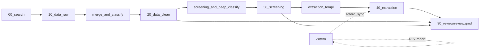

# Systematic review — project folder

PRISMA-based systematic review: soil moisture, remote sensing, UAV / satellite, agricultural context.

### Manuscript

| | |
|---|---|
| Source | `90_review/review.qmd` — open via `90_review/review.Rproj` |
| Structure map | [`90_review/99_aux/manuscript-structure.md`](90_review/99_aux/manuscript-structure.md) |
| Text quality | [`90_review/99_aux/text-quality-review.md`](90_review/99_aux/text-quality-review.md) |
| Files to send | `50_outputs/` (`review.docx`, `online-resources.docx` / `.html` / `.pdf`) |
| Bibliography | [Zotero](https://www.zotero.org/lenka.mikova/collections/HHZVLHAU/collection) → `90_review/full_papers_review.bib` |

### Figures

| | |
|---|---|
| Icons | `80_figures/81_icons/` |
| Figure 1 / Figure 6 | `80_figures/83_others/` (`fig-history.png`, `fig-conclusion.png`) |
| Figure 4 (VOSviewer) | `80_figures/82_VOSviewer/` |
| Figure 2 (PRISMA) | `60_prisma/PRISMA_diagram.png` (`fig-prismadig`) — [redraw assignment](60_prisma/PRISMA_diagram_zadani.md) |
| PRISMA checklist | `60_prisma/PRISMA_2020_checklist_filled.md` |

### Code and GitHub

| | |
|---|---|
| Pipeline + runner | `70_scripts/` · `run_review.bat` (Python check, install on request, one step at a time) |
| Tools repo | [PRISMAtools](https://github.com/LenkaMikova/PRISMAtools) |
| This project (private working copy) | [UAS-review](https://github.com/LenkaMikova/UAS-review) · [GitHub project](https://github.com/users/LenkaMikova/projects/3) |
| Public mirror (no `99_temp/`) | [UAS-review-public](https://github.com/LenkaMikova/UAS-review-public) — `70_scripts/sync_public.py` on push |
| Pipeline I/O | [`90_review/99_aux/pipeline-io.md`](90_review/99_aux/pipeline-io.md) |

### Zenodo (DOI)

Three records, November 2026. GitHub stays the live copy. **Online Resources 1–18 go with the article** (Springer SI / ESM zip). The dataset (`@MikovaData2026`) is screening and extraction tables, plus a **copy** of that ESM in the dataset zip — not a fourth deposit. The runner is inside the software record. Packing list: [`90_review/99_aux/zenodo/README.md`](90_review/99_aux/zenodo/README.md). Pre-submission: [`90_review/99_aux/pre-submission-checklist.md`](90_review/99_aux/pre-submission-checklist.md).

| Record | Type | Licence | DOI | Cite |
|--------|------|---------|-----|------|
| Protocol (retrospective PRISMA-P + checklists) | Publication | CC BY 4.0 | [10.5281/zenodo.24362475](https://doi.org/10.5281/zenodo.24362475) | `@MikovaProtocol2026` |
| Dataset (search/screening/extraction + copy of Online Resources) | Dataset | CC BY 4.0 | [10.5281/zenodo.24362075](https://doi.org/10.5281/zenodo.24362075) | `@MikovaData2026` |
| Software (`70_scripts/` including the runner) | Software | MIT | [10.5281/zenodo.24362240](https://doi.org/10.5281/zenodo.24362240) | `@MikovaCode2026` |

Do not upload downloaded article PDFs or `zotero_config.json`. After a new freeze, tag the GitHub commit that the software DOI points to.

---

## Folder numbering (00 → 90)

Folders are ordered by **workflow stage**. Lower number = earlier step.  
**Naming:** all folder names use **underscores** (no spaces), at every level — e.g. `00_search/02_final/`, not `00 search/02 final/`.

| Folder | Stage | Role |
|--------|--------|------|
| `00_search` | Search strategy | Query development and final strings |
| `10_data_raw` | Raw exports | Original and standardized RIS from WoS / Scopus |
| `20_data_clean` | Merge & deduplication | Clean dataset + audit trail |
| `30_screening` | Title/abstract screening | Scores, decisions, RIS for Zotero, must-cite PDFs |
| `40_extraction` | Data extraction | Excel templates, batches, VOSviewer |
| `50_outputs` | Deliverables | Rendered review: Word, HTML, later PDF — the files you send |
| `60_prisma` | PRISMA reporting | Flow diagrams, filled checklist, official templates, count copies |
| `70_scripts` | Code | Pipeline scripts, runner, Zotero sync, config |
| `80_figures` | Figures | Icons (`81_icons/`), VOSviewer maps (`82_VOSviewer/`), other body figures (`83_others/`) |
| `90_review` | Manuscript (Quarto) | Source only: `.qmd`, bibliography; helpers in `99_aux/` |

**Inner subfolders** follow the same rule (`01_raw`, `21_audit`, `32_exports`, `41_input`, …).

**Manuscript source** lives only in `90_review/`. Open `90_review/review.Rproj`, render with `quarto render review.qmd`, then `python _publish_outputs.py` to copy Word/HTML into `50_outputs/`.

### Folder contents (00 → 90)

#### `00_search/` — search strategy

| Subfolder | Contents |
|-----------|----------|
| `01_raw/` | `Query_combinations.txt`, `search_strategies.json` (from `WoS_Scopus_query.py`) |
| `02_final/` | `final_query.txt` — **frozen query** for WoS and Scopus |

#### `10_data_raw/` — raw bibliographic exports

| Subfolder | Contents |
|-----------|----------|
| `11_original/` | Timestamped RIS exports (unchanged archive) |
| `12_final/` | `export_WoS.ris`, `export_Scopus.ris` — **required names** for scripts |
| *(root)* | `WoS_searchHistory.xlsx` |

#### `20_data_clean/` — merge & deduplication

| Path | Contents |
|------|----------|
| `clean_records.xlsx` / `.csv` / `.ris` | Valid records → screening input |
| `21_audit/` | `all_records_with_status.xlsx`, duplicate checks, `processing_report.txt`, `prisma_counts.csv` |

#### `30_screening/` — title/abstract screening

| Subfolder | Contents |
|-----------|----------|
| `31_dataset/` | `screened_records.xlsx` — main dataset for extraction |
| `32_exports/` | RIS subsets (`include_records.ris`, `core_studies.ris`, `must_cite_records.ris` = 48, …) |
| `33_reports/` | `screening_summary.txt`, `.xlsx`, `keyword_statistics.txt` |
| `34_reviews/` | Review articles separated from analysis |
| `35_VOS-ris/` | `VOS_full.ris` (1 018) + `VOS_must-cite.ris` (48) for Figure 4 |

#### `40_extraction/` — data extraction

| Subfolder | Contents |
|-----------|----------|
| `41_input/` | Excel templates + `batches/` |
| `42_working/` | `extraction_filled.xlsx` *(you create)* |
| `42_reviews/` | Review-article copy (if any) |
| `43_vosviewer/` | VOSviewer CSV exports |
| `43_json/` | `vosviewer_map.json` *(from `ris_to_json.py`)* |
| `43_final/` | `extraction_final.xlsx` *(you create)* |

#### `50_outputs/` — finished manuscript

The files you send: `review.docx` / `.html` / `.pdf`, `online-resources.docx` / `.html` / `.pdf`.
Quarto still writes next to the `.qmd`; after a good render run
`python 90_review/_publish_outputs.py`. Pipeline reports stay in `21_audit/`,
`33_reports/`, `60_prisma/`.

#### `60_prisma/` — PRISMA reporting

| Path | Contents |
|------|----------|
| `PRISMA_diagram.png` | **Figure 2** in the manuscript (`fig-prismadig`) — redraw when counts change |
| `61_diagnostics/` | Copies of duplicate / missing-DOI tables |
| `62_official/` | PRISMA 2020 checklist and official flow-diagram templates |
| `processing_report.txt` | Optional copy — merge/dedup counts from `21_audit/` |
| `prisma_counts.csv` | Optional copy — record status counts for the flow diagram |

Details: `60_prisma/README.md`.

#### `70_scripts/` — pipeline code

| Subfolder | Role |
|-----------|------|
| `pipeline/` | Core workflow: query → merge → screening → extraction templates |
| `zotero/` | `zotero_sync.py`, `zotero_config.example.json` |
| `auxiliary/` | `VOSviewer.py`, `ris_to_json.py`, script template |
| *(root)* | `review_runner.py` (menu), `requirements.txt`, `project_paths.py` |

```bash
cd 70_scripts && python review_runner.py
```

Details: `70_scripts/README.md`.

#### `80_figures/` — figures

Icons (`81_icons/`), VOSviewer maps (`82_VOSviewer/`), and other body figures
(`83_others/`: Figure 1, Figure 6). PRISMA diagrams stay in `60_prisma/`.

#### `90_review/` — manuscript (Quarto / Elsevier)

| Path | Contents |
|------|----------|
| `review.qmd` | Main manuscript — live counts from `21_audit/` and `33_reports/` |
| `online-resources.qmd` | Standalone appendix |
| `full_papers_review.bib` | Active Zotero bibliography |
| `92_appendix/` | Full Online Resources + generated caption list (see that folder’s README) |
| `99_aux/` | Helpers: living maps, canvas git copies, chapter drafts, unused scripts |
| `style-guide/` | Elsevier author documentation |

```bash
cd 90_review && quarto render review.qmd
```

Icons: `../80_figures/81_icons/` · Figure 4: `../80_figures/82_VOSviewer/` · PRISMA: `../60_prisma/PRISMA_diagram.png` · Pipeline data: `../20_data_clean/`, `../30_screening/`

Details: `90_review/README.md`.

### Pipeline overview



---

## Step-by-step: files, scripts, inputs & outputs

The compact chain (including **unchanged / renamed copies**) is
[`90_review/99_aux/pipeline-io.md`](90_review/99_aux/pipeline-io.md).
Folder READMEs describe what sits in that folder. Summary below.

### 0 — Search strategy (`00_search`)

| Item | Location | Description |
|------|----------|-------------|
| Input | — | Keywords entered interactively in script |
| Script | `70_scripts/pipeline/WoS_Scopus_query.py` | Builds WoS + Scopus queries |
| Output | `00_search/01_raw/Query_combinations.txt` | Append-only log of tries |
| Output | `00_search/01_raw/search_strategies.json` | Structured export per run |
| **Final** | `00_search/02_final/final_query.txt` | **Frozen query** used in databases (copy manually when final) |

**Used by:** methods section in `90_review/review.qmd` (Appendix A reads `final_query.txt`).

---

### 1 — Raw bibliographic data (`10_data_raw`)

| Item | Location | Description |
|------|----------|-------------|
| Original exports | `10_data_raw/11_original/` | Timestamped files from databases (unchanged archive) |
| File names | `2026-04-29 export_WoS_eng.ris`, `2026-04-29 export_Scopus_eng.ris` | As downloaded |
| **Renamed copies** | `10_data_raw/12_final/export_WoS.ris` | **Required names** for processing |
| | `10_data_raw/12_final/export_Scopus.ris` | **Required names** for processing |

**Renaming rule:** only files in `12_final/` are read by scripts; names must be exactly `export_WoS.ris` and `export_Scopus.ris` (content unchanged).

**Used by:** `merge_and_classify.py` → step 2.

---

### 2 — Merge & classify (`20_data_clean`)

| Item | Location | Description |
|------|----------|-------------|
| Input | `10_data_raw/12_final/export_WoS.ris`, `export_Scopus.ris` | |
| Script | `70_scripts/pipeline/merge_and_classify.py` | Parse, merge, dedupe, classify (excludes books / e-books only) |
| **Main output** | `20_data_clean/clean_records.xlsx` | `correct_record` rows. After Audit **Save**, screening reads `forward_records.xlsx` |
| | `20_data_clean/clean_records.csv` | Same data, CSV |
| | `20_data_clean/clean_records.ris` | Import to Zotero (full clean set) |
| Audit | `20_data_clean/21_audit/all_records_with_status.xlsx` | All records + status + exclusion reason |
| | `21_audit/duplicates_doi.xlsx` | Manual check |
| | `21_audit/duplicates_title.xlsx` | Manual check |
| | `21_audit/missing_doi.xlsx` | Assign DOI overlay — **not** an automatic exclusion |
| Reports | `21_audit/processing_report.txt` | Counts WoS / Scopus / merged / retained |
| | `21_audit/prisma_counts.csv` | Status counts for PRISMA diagram |

**Used by:** `screening_and_deep_classify.py`; `90_review/review.qmd` (dynamic stats + Appendix B–C).

**Copy in `60_prisma/`:** optional duplicate of `processing_report.txt` and `prisma_counts.csv` for reporting convenience.

---

### 3 — Screening (`30_screening`)

| Item | Location | Description |
|------|----------|-------------|
| Input | `20_data_clean/forward_records.xlsx` (after Audit Save) or `clean_records.xlsx` | |
| Script | `70_scripts/pipeline/screening_and_deep_classify.py` | Rule-based scoring & categories |
| **Main dataset** | `30_screening/31_dataset/screened_records.xlsx` | Non-review records + all new columns → **extraction input** |
| Reports | `33_reports/screening_summary.txt` | PRISMA-ready counts |
| | `33_reports/screening_summary.xlsx` | Tables |
| | `33_reports/keyword_statistics.txt` | Platform, UAV, scaling stats |
| **RIS exports** | `32_exports/all_records.ris` | All screened (non-review), n = 1 018 |
| | `32_exports/include_records.ris` | `include` only → Zotero |
| | `32_exports/core_studies.ris` | Strict must-cite (direct UAV + scaling), n = 22 |
| | `32_exports/extended_studies.ris` | Extended must-cite, not strict, n = 26 |
| | `32_exports/must_cite_records.ris` | **core ∪ extended**, n = 48. Do not merge with extended_studies.ris |
| | `32_exports/must_cite_list.xlsx` | 48 / 45 lists + `Scaling_source` (22 automaticky, 26 ručně) |
| | `32_exports/HIGH_Scaling_none_with_abstracts.xlsx` | Recode the 23 `none` HIGH records (one tick: fusion / downscaling / multi-scale / **one source** / **ostatní**) |
| **VOS pair** | `35_VOS-ris/VOS_full.ris` | Same records as `all_records.ris` — left panel of Figure 4 |
| | `35_VOS-ris/VOS_must-cite.ris` | Same records as `must_cite_records.ris` — right panel |
| Reviews | `34_reviews/review_articles.xlsx`, `.ris` | Excluded from analysis |
| | `34_reviews/review_articles_uav.ris` | UAV-related reviews (optional) |

**Screening decisions** (score 0–8): `include` ≥ 6, `maybe` 3–5, `exclude` < 3.

**Used by:** `extraction_templ.py`, `VOSviewer.py`, `ris_to_json.py`; `90_review/review.qmd` (Appendix D); Zotero import from `32_exports/`; Figure 4 from `35_VOS-ris/`.

Details: `30_screening/README.md`.

---

### 4 — Data extraction (`40_extraction`)

| Item | Location | Description |
|------|----------|-------------|
| Input | `30_screening/31_dataset/screened_records.xlsx` | |
| Script | `70_scripts/pipeline/extraction_templ.py` | Builds Excel templates + batches |
| Templates | `41_input/extraction_input_full.xlsx` | *include* + *maybe* (973 = 249 + 724) |
| | `41_input/extraction_input_refined.xlsx` | *include* only (249), `Priority == HIGH` = 48 must-cite. `Scaling_type` + `Scaling_source` (22 automaticky / 26 ručně). Figure 5 reads this file |
| | `41_input/batches/batch_1.xlsx` … | ~50 records per batch |
| Reviews copy | `42_reviews/review_articles.xlsx` | If any reviews left in screened file |
| Working | `42_working/extraction_filled.xlsx` | **You create** — copy from refined, fill manually |
| Final | `43_final/extraction_final.xlsx` | **You create** — after full-text inclusion |
| VOSviewer | `43_vosviewer/vosviewer_nodes.csv`, `vosviewer_links.csv` | From `VOSviewer.py` |
| JSON map | `43_json/vosviewer_map.json` | From `ris_to_json.py` (if run) |

**Zotero sync** (`zotero_sync.py`) fills `Zotero_key` and `Notes` in Excel (not in `.bib` export).

Details: `40_extraction/README.md`, `42_working/README.md`.

---

### 5 — Manuscript (`90_review/` source, `50_outputs/` files to send)

| Item | Role |
|------|------|
| `90_review/review.qmd` | Article text + live counts from `21_audit/` and `33_reports/` |
| `90_review/full_papers_review.bib` | **You export** from Zotero → citations (`@key`) |
| `80_figures/81_icons/` | Table icons |
| `80_figures/83_others/` | Figure 1 (`fig-history.png`) and Figure 6 (`fig-conclusion.png`) |
| `80_figures/82_VOSviewer/` | Figure 4 (VOSviewer overlay, `VOS_must-cite.png`) |
| `60_prisma/PRISMA_diagram.png` | Figure 2 — numbers current; full-text story still wrong (`PRISMA_diagram_zadani.md`) |
| `60_prisma/PRISMA_2020_checklist_filled.md` | Working PRISMA 2020 checklist; copy into the official DOCX to submit |
| `50_outputs/` | Word / HTML / later PDF after `python 90_review/_publish_outputs.py` |

Re-render after re-running pipeline scripts so counts in Abstract/Results update. Then publish:

```powershell
cd 90_review
quarto render review.qmd
quarto render online-resources.qmd
python _publish_outputs.py
```

---

## How to run scripts {#how-to-run-scripts}

**Preferred:** `run_review.bat` in this folder (`70_scripts/runner/`). One pipeline step at a time; Audit Save writes `forward_records.xlsx`. Snapshot first: `python 70_scripts/original_run.py backup`.

### First-time setup

```powershell
cd "...\review\70_scripts"
python -m pip install -r requirements.txt
```

Dependencies: `pandas`, `openpyxl`, `pyzotero` (for Zotero sync).

### Menu (recommended)

```powershell
python review_runner.py
```

| Choice | Script | Interactive? |
|--------|--------|----------------|
| 1 | `pipeline/WoS_Scopus_query.py` | Yes — enter keyword groups |
| 2 | `pipeline/merge_and_classify.py` | No |
| 3 | `pipeline/screening_and_deep_classify.py` | No |
| 4 | `pipeline/extraction_templ.py` | No |
| 5 | `zotero/zotero_sync.py` | Yes — pick Excel file |
| 6 | Install requirements | — |
| 10–15 | Open data folders | — |

### Individual commands

```powershell
cd "...\review\70_scripts"

python pipeline/WoS_Scopus_query.py
python pipeline/merge_and_classify.py
python pipeline/screening_and_deep_classify.py
python pipeline/extraction_templ.py
python zotero/zotero_sync.py
python zotero/zotero_sync.py --show-id    # test Zotero config only
```

### Auxiliary scripts (optional, not in menu)

| Script | Input | Output | Purpose |
|--------|-------|--------|---------|
| `VOSviewer.py` | `screened_records.xlsx` or `all_records.ris` | `40_extraction/43_vosviewer/*.csv` | Co-occurrence network for VOSviewer |
| `ris_to_json.py` | same | `40_extraction/43_json/vosviewer_map.json` | JSON network |
| `+sablona.py` | — | — | Local template helper |

Run from `70_scripts/auxiliary/` only after step 3 (screened data exists).

---

## Zotero workflow

1. **Import RIS** from `30_screening/32_exports/` (e.g. `include_records.ris`, `core_studies.ris`).
2. Add PDFs, tags, and **notes** in Zotero.
3. Configure `70_scripts/zotero/zotero_config.json` (see `zotero/zotero_config.example.json`).
4. Run `python zotero/zotero_sync.py` → fills `Zotero_key` + `Notes` in extraction Excel.
5. For the article: export collection → `90_review/full_papers_review.bib`.

| Data | `.bib` export | `zotero_sync.py` |
|------|---------------|------------------|
| Citations for Quarto | Yes | No |
| Item key | With Better BibTeX | Yes |
| Notes | No | Yes |

---

## Script documentation

| Script | Short doc |
|--------|-----------|
| All tools overview | `70_scripts/README.md` |
| Query generator | `70_scripts/pipeline/WoS_Scopus_query_info.md` |
| Merge & classify | `70_scripts/pipeline/merge_and_clssify_info.md` |
| Screening | `70_scripts/pipeline/screening_and_deep_classify_info.md` |
| Extraction templates | `70_scripts/pipeline/extraction_templ_info.md` |
| Zotero sync | `70_scripts/zotero/zotero_sync_info.md` |

---

## Typical order (full rerun)

1. Export new RIS → rename → `10_data_raw/12_final/`
2. `python pipeline/merge_and_classify.py`
3. `python pipeline/screening_and_deep_classify.py`
4. Import selected RIS into Zotero
5. `python pipeline/extraction_templ.py`
6. `python zotero/zotero_sync.py`
7. Manual full-text → `42_working/extraction_filled.xlsx`
8. `cd 90_review` → `quarto render review.qmd` → `python _publish_outputs.py`

---

## Files you edit vs generated

| You edit manually | Generated by scripts |
|-------------------|----------------------|
| `00_search/02_final/final_query.txt` | Most of `00_search/01_raw/` |
| `10_data_raw/11_original/` (archive) | `20_data_clean/`, `30_screening/` |
| Renaming → `12_final/*.ris` | `40_extraction/41_input/` |
| `42_working/`, `43_vosviewer/` Excel/CSV | Reports `*.txt`, `*.csv` |
| `90_review/full_papers_review.bib`, `90_review/review.qmd` text | `zotero_config.json` (local, not on GitHub) |

---

## Troubleshooting

- **Wrong paths / empty outputs:** run scripts from `70_scripts/`; ensure parent folder is this `review/` directory.
- **Excel errors:** `pip install openpyxl`
- **Zotero 403:** check API key permissions at [zotero.org/settings/keys](https://www.zotero.org/settings/keys)

---

This public repository is a filtered mirror of the private working copy [UAS-review](https://github.com/LenkaMikova/UAS-review) at `2c0ba4b`. Personal notes live only on the author’s machine (`99_temp/`).
